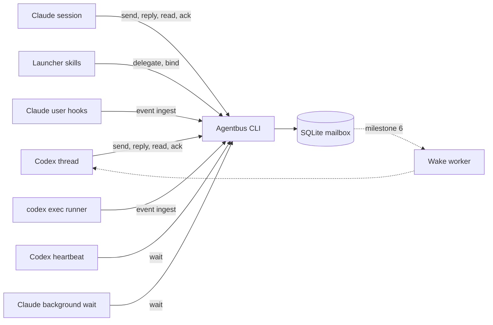

# Agentbus implementation plan

Status: milestones 1–5 implemented and their live gates passed; follow-ups reach working Claude workers through a doorbell hook (2026-10-04); the Claude Desktop resume checks remain open (see [Remaining implementation questions](#remaining-implementation-questions)). This file is the live design and open work; completed task lists, evidence and the revision log are in [docs/history.md](docs/history.md).

Agentbus is a local CLI for communication between agent sessions. It supports delegation in every direction between Codex and Claude Code:

- A Codex thread delegates work to a Claude Code session.
- A Claude Code session delegates work to a Codex thread.
- A Claude Code session leads several Claude Code child sessions; this replaces the tracking half of the `claude-threads` skill.

In each case the parent receives progress, questions and the result in its original conversation. The mailbox is provider-agnostic; provider adapters handle observation and wake-up.

Deliver in order of certainty: durable messaging, then worker result capture, then end-to-end delegation between providers, then `claude-threads` on Agentbus, and only then an automatic Codex wake adapter. Storing a message, requesting a new turn, acknowledging a message and completing a task remain separate events.

## Initial scope and decisions

| Decision | Initial implementation |
| --- | --- |
| Directory | `~/dev/agentbus` (or another local checkout) |
| Command | `agentbus` |
| Package | `@vforsh/agentbus` (free on npm as of 2026-09-30); public repository `vforsh/agentbus`, MIT licensed |
| Runtime | Latest stable Bun at implementation time, latest stable TypeScript; Bun tooling throughout |
| Dependencies | Commander for arguments, Zod for boundary validation, Picocolors for human output |
| Storage | SQLite through `bun:sqlite`, rollback journal; SQL migrations and prepared statements |
| Platforms | macOS first; keep the mailbox portable to Linux |
| Deployment | Local checkout and `bun link` after implementation passes its gates |
| Directions | Codex→Claude and Claude→Codex (milestone 4) and Claude→Claude (milestone 5), each verified by a live gate. Codex→Codex is protocol-compatible but outside the release gates |
| Launching | The skills `codex-to-claude`, `claude-to-codex` and `claude-threads` remain the launchers. They share one Agentbus sequence: `delegate`, spawn, `session bind` |
| Process model | Short-lived CLI processes, Claude hooks and the existing `codex exec` runner; no daemon or long-running worker unless a verified wake adapter ships |
| Trust boundary | One OS user on one host; session identities are routing labels, not authenticated principals |
| Verification | Integration, process-level and end-to-end checks; no unit tests or unit-test targets |

The first release supports one recipient per message and text payloads. Cross-host routing, remote authentication, a web UI, file synchronization, automatic (scheduled) retention and automatic task execution are later extensions; explicit `prune` is in scope. Agentbus supplies identity, correlation, result capture, delegation state, the worker contract and parent wake-up. The launcher skills keep model, permission, worktree and Desktop-handoff logic.

### Review decisions that constrain implementation

- Mailbox persistence is the guarantee. Seen state, provider observations and wake receipts are weaker evidence; none proves that an agent processed a message or stopped editing.
- One open delegation per worker session, with arbitrarily many children per parent. A session can be both a worker and a parent. New concurrent tasks get separate worker sessions.
- A retry of `delegate` recovers the same request; it does not authorize another model launch. Launchers need durable launch records and exclusive ownership across initial launch, resume and Desktop handoff.
- Every wake, including timeouts and heartbeats, recovers unacknowledged mail before re-arming. Batch waits must surface questions, permissions and failures before waiting for the whole batch.
- Automatic continuation requires positive correlation to a delegated turn or background task. A `<task-notification>` prefix alone is insufficient.
- Unknown liveness stays unknown. Missing provider rows and dead supervisor processes do not prove that a worker stopped.

## Roles and paths

Every delegation has a **parent** (the requester) and a **worker** (the recipient of the request). The provider of each role determines how events are observed and how the other side is woken. Claude→Claude combines the Claude rows of both roles.

| | Claude | Codex |
| --- | --- | --- |
| **As worker: launched by** | `codex-to-claude` or `claude-threads` → `claude --bg` | `claude-to-codex` → detached runner around `codex exec` |
| **As worker: observed through** | Per-worker Claude hooks from `--settings`, while the background owner runs it | The runner, while `codex exec` owns the thread |
| **As worker: follow-up delivery** | Live session: the worker arms a background wait after asking | In-turn wait, or the parent resumes the thread with `codex exec resume` |
| **As parent: woken by** | One background `agentbus wait`, covering all its delegations | A heartbeat on the original chat; automatic wake is milestone 6 |
| **As parent: identity** | `CLAUDE_CODE_SESSION_ID` in Desktop sessions, otherwise explicit | `CODEX_THREAD_ID` |

Tracking a Codex worker is required only while `codex exec` owns it. Once the user opens the thread in Codex Desktop, Desktop owns it: explicit mailbox replies still work, and lifecycle observation becomes best effort (optional Codex hooks, milestone 7).

## Acceptance criteria

First release (milestones 1–4):

1. Two independent processes can register sessions, exchange a request and reply, and acknowledge messages through the installed CLI.
2. A committed message survives sender exit, reader interruption and a subsequent CLI process reopening the database.
3. Repeating a send or delegation with the same sender and idempotency key returns the original IDs and contract, even after task closure; changing its intent produces a conflict. A retry does not launch a second worker.
4. Default reading or waiting does not acknowledge a message. `read`, including `--unseen`, leaves receipts unchanged unless `--ack` explicitly accepts the returned batch. `reply` acknowledges its source atomically unless `--no-ack`. `wait` atomically marks its returned batch seen; every consumer also recovers unacknowledged mail after a lost output, restart or timeout, without a client-side cursor.
5. Observed permission requests, turn failures, interruptions, tracking loss and normal turn ends produce distinct notices. Repeated permission requests in one prompt are preserved. Finishing a turn never means the task succeeded; only a worker-authored `result` carries an outcome. The support matrix names provider prompt types the selected hooks do not cover.
6. With a writable compatible store, a delegated Claude turn's final response reaches the parent's inbox through the worker's per-worker hook alone while its background owner runs it (after a Desktop handoff only with the optional user-level install), unless an explicit question/result already replaces that finish notice. Otherwise an eligible captured event is spooled and later drained, or an observation gap is surfaced when diagnosable; successful spooling is not yet inbox delivery.
7. When a delegated `codex exec` run finishes or fails, the parent's inbox contains Codex's final message or the failure, reported by the runner.
8. Later turns that were not started for the delegation are not attributed to it: a manual Claude prompt, an unrelated background-task completion, or a Codex turn outside the runner. Delayed spool events cannot rebind a newer turn.
9. A Codex parent collects the result after its initial turn has ended, through a heartbeat or a verified wake adapter. A missing adapter leaves the message available and reports the missing capability.
10. A Claude parent is re-invoked by its background wait when a question, result or notice arrives, without user input. Answering a Codex worker's question resumes the same thread ID without a fork, and is refused while the run is active or after Desktop may have taken the thread.
11. Hooks exit 0 quickly and write nothing for unregistered sessions or when Agentbus is unavailable, for example while the external volume holding the checkout is unmounted.
12. Help, diagnostics and JSON errors are useful without exposing payload bodies in routine logs.

`claude-threads` on Agentbus (milestone 5):

13. One armed wait wakes a Claude lead for any event from any of its Claude children, including children spawned after the wait was armed. A child's explicit question or result is never followed by a redundant `turn_finished` notice for the same turn.
14. `agentbus delegations` shows each child's phase and the age of its evidence, including `unknown` when tracking is lost. A child confirmed dead without any hook firing is reported as interrupted by `wait --probe`; a failed probe is never interpreted as death.

Wake adapter, required only if milestone 6 ships one:

15. A wake attempt reports its actual stage: pending, dispatching, accepted, unsupported, failed or uncertain. It never claims the model read a message based only on provider acceptance.
16. Killing and restarting a wake worker cannot silently discard a wake. A dispatch with an unknown outcome remains `uncertain` and is not redispatched automatically; exactly-once provider execution is not promised without provider idempotency.

## Architecture



Use three layers:

- **Mailbox:** sessions, immutable messages, per-message seen and acknowledgement state, delegations with derived phases, and normalized observations. It knows nothing about providers beyond identity formats.
- **Provider adapters:** Claude hook ingestion and on-demand probing of `claude agents` and Claude job state; ingestion of Codex runner events; later, wake dispatch through verified interfaces only.
- **Agent workflow:** one consumer skill covers both roles: when to read, reply and acknowledge, which task scope is authorized, how to wait as a parent, and how to act on another agent's result. The per-provider worker contract is generated by `agentbus delegate`, so launchers do not each maintain their own.

The mailbox must work with provider adapters disabled. Core commands neither launch models nor require a running daemon. Adapters must not edit another product's database or state files, inject keystrokes, or treat terminal redraws as a message protocol.

### Sessions and addressing

Each registered session has an internal UUID, provider, native identifier, display name, canonical project directory, labels and adapter binding:

- Provider values are `codex`, `claude` and `generic`, plus the reserved `system` provider. The initial migration creates `system:observer`; users cannot register `system` sessions.
- Labels are a small string map (at most 16 entries), for example `model=opus`, `effort=xhigh` or `worktree=review-api`. They are display metadata shown in tables and never used for routing.
- The adapter binding holds provider-specific handles: the Claude short ID, or the Codex runner directory and PID.
- Parent workflow metadata holds a return binding: strategy, automation/task handle when available, last check-in time, optional heartbeat `interval` and reason. The parent records it through `session update --binding-file <path|->` and renews the check-in with `session update --refresh`; this is a reported observation, not a guarantee that a provider is running. Current readiness is derived from evidence each time it is shown (see [Return-path readiness](#return-path-readiness)).

Accept either an internal UUID or `provider:<native-id>` as an address. Names are display metadata, not routing addresses; a name may also select a delegation in `delegations` and `close` when it is unambiguous among the caller's own delegations. Resolve one exact match; reject ambiguity and unknown recipients. Codex and Claude native IDs use their adapters' validated full identifiers (currently UUIDs); the short IDs printed by `claude --bg` are CLI handles, not identities. Generic IDs are bounded opaque strings; `system:observer` is a reserved address.

Registration is idempotent on `(provider, external_id)` within this host's store. `--cwd` defaults to the current directory. Preserve the supplied directory for display and its resolved real path for comparison, since `~/dev` resolves to `/workspace`. A changed backend binding requires an explicit update and revalidation.

**Pending workers.** A worker's native ID is unknown until it starts, and it may act before the launcher reads that ID back. Every launcher therefore opens the delegation before spawning:

1. `agentbus delegate --to <claude|codex> --file <request>` creates a pending worker session (internal UUID, no native ID). In the same transaction it sends the request and opens the delegation. It returns the worker ID, the request ID and the worker contract.
2. The launcher appends the contract to the worker prompt and spawns the worker.
3. The native ID is bound once known:
   - Claude: `claude --bg --session-id <uuid>` ignores the flag (2026-09-30 evidence). The first `UserPromptSubmit` with exactly one generated contract block for an open delegation claims its pending Claude worker in one transaction. Validate the provider, worker ID and expected canonical working directory; ambiguous or quoted tokens outside the contract block do not claim. The launcher then confirms with `session bind`, using the UUID from `claude agents --all --json`, and records the short ID in the adapter binding. Finalize the worker directory before launch, including a requested worktree's actual path.
   - Codex: the runner reads `thread_id` from the `thread.started` event of `codex exec --json` and runs `session bind`, recording its run directory and PID. No hook is involved.
4. `session bind` succeeds when the binding already matches and fails with a conflict when it differs.

Pending sessions cannot be claimed by name or working directory alone. Delivery works before binding: messages address the internal UUID. The token/contract checks prevent accidental association, not deliberate spoofing by the same OS user.

Creating a mailbox request and launching a provider cannot be one atomic transaction. Launchers persist a manifest keyed by request ID before spawning, with `prepared`, `starting`, `bound`, `failed` or `uncertain` launch state and any observed native handles. An exclusive launcher lock prevents concurrent attempts for the same request; a crash after `starting` requires reconciliation against provider evidence, not a blind second spawn. Known pre-launch failure leaves a recoverable pending delegation that the parent can retry deliberately or close. Missing proof after an ambiguous launch produces `uncertain`; it must not restart automatically.

**Caller resolution**, first match wins:

1. `--as <address>`.
2. `AGENTBUS_SESSION_ID`.
3. Native session environment: `CLAUDE_CODE_SESSION_ID` maps to `claude:<id>`, and `CODEX_THREAD_ID` maps to `codex:<id>`. Ignore `CLAUDE_CODE_HOST_SESSION_ID`, which identifies the Desktop host.

Native detection refuses to guess when markers from more than one provider are present. This happens in practice: a `codex exec` started from Claude inherits the parent's `CLAUDE_CODE_SESSION_ID` next to its own `CODEX_THREAD_ID`. Workers resolve identity as follows:

- **Codex worker:** the runner sets `AGENTBUS_SESSION_ID=<worker-id>`, which `codex exec` passes to tool shells, and removes the inherited `CLAUDE_CODE_SESSION_ID` from the worker environment.
- **Claude worker:** `claude --bg` passes neither the launcher's environment nor `CLAUDE_CODE_SESSION_ID` to its Bash tool, so it uses the explicit `--as` from its contract.

The ambiguity rule cannot catch a same-provider leak, where a Claude child would inherit its Claude lead's ID. So the contract always names the worker's address explicitly. Recipient checks catch that accidental mismatch: only the request's recipient can acknowledge it or reply to it. They are not authentication: any process running as this OS user can supply another `--as` or access the database. `whoami` prints the resolved address, its source and registration state. Sending, replying, acknowledging and closing require a registered caller; registration, `whoami` and diagnostics do not. `system:observer` cannot be selected by `--as`, environment or public send/reply operations; only the ingestion service can author notices.

### Message contract

Use a versioned envelope with these fields:

| Field | Meaning |
| --- | --- |
| `schemaVersion` | Envelope version, initially `1` |
| `id` | Random UUID; stable across retries |
| `sequence` | Database insertion order; JSON integer |
| `from`, `to` | Internal session UUIDs |
| `type` | `message`, `request`, `progress`, `question`, `result` or `notice` |
| `summary` | Optional single line, at most 200 characters, shown in tables and listings; notices get one derived from their excerpt |
| `body` | UTF-8 text, copied into SQLite rather than retained only as a file path |
| `createdAt` | UTC timestamp |
| `correlationId` | Root request ID; new requests default to their own message ID |
| `inReplyTo` | Optional parent message ID |
| `idempotencyKey` | Optional caller-supplied retry key, unique per sender |
| `outcome` | For `result` only: `success`, `blocked`, `failed` or `unknown` |
| `notice` | For `notice` only: `{kind, observationId, provider, truncated?}`; kind is `turn_finished`, `turn_failed`, `turn_interrupted`, `permission_request` or `tracking_lost`; truncated excerpts also record original byte length |
| `turnRef` | Optional immutable reference to the worker's bound turn; assigned and checked by Agentbus, used for notice suppression and lifecycle attribution |
| `seenAt`, `acknowledgedAt` | Recipient state, derived from their tables; nullable; not part of the idempotency hash |

Authorship rules make evidence structural rather than a naming convention:

- `result` is authored by the worker and is the only type that carries an outcome. A failed task is `result` with `outcome: failed`; there is no separate error type.
- `notice` is authored only by `system:observer`. Its body is the relevant excerpt: final assistant text, a bounded failure/tracking reason, or the tool name and a short input summary for permission. Notices cannot be replied to; the delegation identifies their worker. Avoid copying secret-bearing tool arguments into permission summaries.

`reply` derives the recipient and correlation ID from the original message. Only the original recipient can reply through this operation. Task messages (`progress`, `question`, `result`) must use `reply` within an open delegation, from its worker to its parent; a parent answers a particular question with a `message` reply whose `inReplyTo` names that question. Ordinary `message` exchanges remain available outside delegations. Public `send` accepts only `message` or a new root `request`; `reply --type request` is rejected (nested delegation uses a new `delegate` or `send --type request`). Keep bounded provider payloads in observations, never in ordinary messages.

A `request` (sent directly or through `delegate`) opens a delegation, keyed by the request message ID, in the same transaction. It records the parent, worker and state. It closes when the worker replies with `result` or when the parent runs `close`. It does **not** close when a provider process ends: `claude stop` during Desktop handoff and every `codex exec` exit both fire `SessionEnd`, while the conversation continues.

Enforce one open delegation per worker, prohibit self-delegation, and reject a second terminal result or a new task message after closure. A `success` result also requires every parent-to-worker message of the delegation other than the request (follow-ups and answers) to be acknowledged by the worker; the check runs in the result's transaction and fails with `followups_pending` (exit 5) naming them. Seen is not handled. Other outcomes hand the task back and are accepted, reporting the unacknowledged ones as unhandled; a parent's `close` is never gated. Parent mail into an ended delegation (`followup`, or a reply to a worker message) is refused with `delegation_closed`, so a follow-up is always either handled or visibly rejected. The first terminal transition wins transactionally; an exact keyed retry still returns its original receipt even after closure. `close` is idempotent for an already closed delegation and never stops a process. Every result outcome is terminal, including `blocked` and `unknown`; use `question` for a blocker that should be resolved within this delegation. A fresh request is required to restart a terminal task.

V1 permits one unresolved worker question per delegation; bundle related decisions into that question. Parent answers use stable keys derived from the question ID. Acknowledging either side changes delivery state only; the exact reply link records resolution.

Use a proposed 1 MiB body limit to accommodate long handoff packets while bounding memory and database growth. Reject invalid UTF-8, unsupported envelope versions and excess input with actionable errors. Referenced project artifacts remain ordinary paths; copying attachments is a later feature.

### Delivery, seen state and retries

Messages are committed before any success receipt is printed. Committed messages remain recoverable until explicitly acknowledged; delivery attempts may be lost or repeated. Agentbus does not promise exactly-once consumption or task execution.

Each recipient message moves through three states: **unseen**, **seen** and **acknowledged**.

- `wait` returns unseen, unacknowledged messages matching its filters and marks them seen in the same transaction that selects them, then prints them. A re-armed wait therefore returns only unseen work, without a client-side cursor. The recovery loop below handles the gap between committing seen state and delivering stdout.
- `read` returns unacknowledged messages by default without changing receipts. `read --unseen` is also non-mutating and filters to unseen, unacknowledged messages. `--all` is history mode, incompatible with `--unseen`.
- `read --mark-seen` explicitly marks only its selected page seen before stdout, with source `read`, without acknowledgement; it is incompatible with `--ack`. Other reads remain non-mutating.
- `ack` means the receiving workflow accepted responsibility; it also sets `seenAt` if needed so an acknowledged message cannot wake a waiter.
- `reply` acknowledges the source in the same transaction unless `--no-ack`; validation failures leave it pending. A keyed retry may acknowledge its source without duplicating the reply. `read --ack` explicitly accepts only its selected page before stdout; lost output does not undo acceptance, so its bodies are recovered with `show` or `read --all`.

Seen is a delivery hint, not consumption. There is an unavoidable commit-to-stdout gap: a killed waiter may mark a message seen without delivering its output. Every workflow runs a paginated `read` recovery sweep at startup and on **every** wake, including timeout, before processing new wait output or re-arming. Heartbeats do this even when `wait` returns no messages. A seen-but-unacknowledged message may be handled again; side effects need their own stable retry keys. A deliberately deferred question can be acknowledged after its pending action is recorded durably in the delegation workflow; acknowledgement itself neither answers it nor clears its phase.

Use one logical consumer per session (one unfiltered parent watcher also serves nested workflows); concurrent `wait` calls atomically partition unseen messages and do not broadcast. A second watcher is a workflow error, not a reliability mechanism. `read` remains available for diagnosis and recovery. Wait receipts report `hasMore`; paginate recovery reads to exhaustion so the default limit of 50 cannot strand mail.

Scope idempotency keys to the sender. Compare a canonical hash of recipient, body, summary, type, correlation, reply target and outcome on retry. Reusing a key for a different request fails. An unkeyed send creates a fresh message, so automated producers must supply stable keys.

For a new root request, hash the caller's intent before allocating IDs; represent its self-correlation symbolically. `delegate` hashes its provider, canonical directory, body, name, labels and summary, excluding generated worker/request IDs and output-file paths. Persist the contract version and original contract alongside the request so retries after an upgrade return the same text. Retry-key lookup and conflict comparison precede current-state checks. Concurrent keyed calls create one request and one worker. If `--contract-out` fails after commit, return the committed IDs and a file-write error; a keyed retry can recreate the file without launching or creating another worker.

Acknowledgements are idempotent and recipient-scoped. They do not prove a task succeeded or even that a provider started a model turn. Support multiple acknowledgements atomically; validate the complete set first.

Every `read` and `wait` receipt includes `cursor`, the highest returned `sequence` (the supplied cursor, or null, if empty), and `hasMore`. `read --all --after <cursor>` pages history. `wait --after` only narrows eligible unseen mail; advancing a cursor is not acknowledgement. Recovery sweeps start without a saved cursor so older pending mail cannot be skipped. Return safe JSON integers and fail rather than silently rounding a sequence outside JavaScript's safe integer range.

### Observation and task outcome

Keep these independent:

- Session activity: `running`, `awaiting_input`, `idle`, `stopped` or `unknown`.
- Native owner: `background`, `desktop`, `exec`, `interactive` or `unknown`.
- Observed lifecycle event: `turn_started`, `turn_finished`, `turn_failed`, `turn_interrupted`, `permission_request`, `tracking_lost` or `owner_released`.
- Explicit request outcome: `success`, `blocked`, `failed` or `unknown`.

Activity and owner are observations with `observedAt` and source, never timeless facts. Lifecycle events come from Claude hooks, the Codex runner and `wait --probe`. Each observation records its source (`claude-hook`, `codex-runner` or `probe`), capture and ingestion timestamps, delegation, binding generation, internal turn reference and native turn ID when available. `owner_released` is recorded but posts no notice. Outcome comes only from a worker-authored `result`. Missing process metadata is unknown state, not successful completion.

**Event identity and ordering.** Allocate a source-event UUID once at capture and retain it through direct-ingest retries and spooling. Use a provider occurrence ID when available; runner events use persisted `(runId, eventOrdinal)` keys. A `(session, turn, kind)` key is insufficient: one prompt can request permission repeatedly, and other Stop hooks can cause multiple Stop events. Claude's documented `PermissionRequest` payload lacks `tool_use_id`, so do not invent one or collapse identical tool inputs. Replaying a captured event ingests once; deduplication of separate hook invocations without a provider occurrence ID is best effort. [Claude PermissionRequest input](https://code.claude.com/docs/en/hooks#permissionrequest-input).

Persist turn bindings rather than keeping only a session's current turn. Delayed events update their original turn and cannot overwrite a newer binding generation. Preserve source order where available; conflicting or unorderable events yield unknown activity, never an inferred success. Optional Codex hooks can deduplicate against runner reports only when a shared native occurrence can be proven; they must not double-publish terminal notices merely because both sources are enabled.

**No redundant notices.** A `turn_finished` notice is posted only if the worker sent no `question` or `result` attributed to that exact bound turn; `progress` does not count. Assign `turnRef` transactionally on task replies, draining eligible earlier hook events first. Never infer membership from the latest message across the whole session. If attribution is unavailable, preserve the message and report the uncertainty rather than suppressing unrelated notices. The observation, suppression decision and optional notice commit atomically. An explicit question suppresses the normal finish notice, but not a later failure or interruption that prevents the answer from being delivered.

**Interruption.** `turn_interrupted` is posted in either case:

- `SessionEnd` belongs to the same owner generation as an open bound turn with no terminal event, or releases an owner with known delegated background work still outstanding.
- `wait --probe` positively establishes that the worker process for the recorded run has ended without a terminal event. Verify process start identity as well as PID to avoid PID reuse. For Codex, inspect both runner and `codex exec` child identities: a dead runner can leave the child editing files.

A missing Claude row, failed probe, inaccessible metadata or dead runner with a live/unknown child yields `tracking_lost` and phase `unknown`, not `turn_interrupted`. Deduplicate probe notices per run and evidence transition. A stale probe must compare the current run generation again inside its commit transaction; it cannot interrupt a replacement run. Tracking loss never authorizes another launch or cleanup.

### Delegation phase

Each open or recent delegation has a derived **phase**, computed from its messages and observations rather than from provider model classifiers. Evaluate terminal state first, then the current binding generation. An answered question is resolved by an exact parent reply to its ID, not by any later parent message. Historical events cannot override a newer turn. Expose phase evidence and its age alongside the phase.

| Phase | Derived when |
| --- | --- |
| `pending` | Initial launch or delivery of an answered question has not yet started its bound turn |
| `working` | A bound turn is active, or its Stop reports delegated background work still running, with no unresolved question or permission |
| `permission` | A permission request was observed with no subsequent evidence of resumption; this is a last-known condition, not proof a prompt remains open |
| `question` | An unresolved explicit question remains; ordinary Stop does not clear it |
| `idle` | Bound work ended without a result, outstanding question, permission or known background work |
| `interrupted` | The latest bound work was interrupted or failed, with no later resumption |
| `unknown` | Tracking was lost, the binding was superseded by unrelated input, or the evidence cannot establish activity |
| `done` | Closed by the worker's `result`; the outcome is shown next to it |
| `closed` | Closed by the parent without a result |

Within an open generation, failure/interruption or tracking loss overrides working/question/permission; retain any unresolved question separately. Otherwise outstanding permission takes priority over question, then working, pending and idle. A later bound turn can recover from interrupted/unknown. Clear a permission condition only on later same-turn progress, terminal evidence or a probe that positively establishes resumption; acknowledging its notice does not approve a tool. Unknown/background state blocks automatic handoff and file-ownership transfer.

### Delegated turn binding

Each worker prompt carries a delimited, versioned contract from `delegate`, including `agentbus-request: <message-id>` and the internal worker ID. It is a routing marker, not an authentication secret. Parse exactly one contract block; nested/quoted request text must not act as a launch contract.

**Claude worker.** `UserPromptSubmit` and `Stop` both carry `prompt_id`, which gives exact turn identity. For a registered Claude session with an open delegation:

- `UserPromptSubmit` carrying the contract binds its `prompt_id` to that delegation and owner generation.
- A `<task-notification>` is a continuation only when its task ID has a verified creation association with the bound turn, or its structured Agentbus wait receipt identifies that delegation and originating bound turn. Presence in a session-wide Stop task inventory alone does not prove origin. Capture a wait's origin when arming it, independent of the correlation IDs of incoming messages (a worker may also have children). Record the new prompt ID as a separate turn linked to its predecessor; it need not equal the earlier `prompt_id`. The marker alone never binds unrelated notifications. Wait-receipt provenance passed live; completion before Stop stays attributable because the wait's origin is recorded when it is armed.
- Any other prompt, such as a manual Desktop follow-up, ends automatic inheritance of the binding. Preserve the old turn records for late events, but do not let an old background notification rebind the newer conversation. If continuation provenance cannot be established, require an explicit contract-bearing follow-up and report the automatic route unsupported.
- `Stop` for a bound `prompt_id` records `turn_finished`. Unless suppressed (see above), it posts a notice containing `last_assistant_message` to the parent. `Stop` also lists the session's `background_tasks`; the notice states whether any are still running, since Claude will then take another turn.
- `StopFailure` posts `turn_failed`. `PermissionRequest` posts `permission_request` as a need for user input; the hook never answers it. `SessionEnd` records `owner_released`, or posts `turn_interrupted` when a bound turn is open.

**Codex worker.** Binding is structural: a delegation is bound to the `codex exec` runs that its launcher starts, meaning the initial run and parent-initiated resumes, each carrying the token. Allocate and persist a new `runId` before each exec, including resume; retain any native turn ID as additional metadata. The JSON stream's `turn.started` has no turn ID (documented example and Codex CLI 0.157.1), so v1 must not depend on one. Create the run binding before launch and ingest `turn_started` when that event is observed, not merely when `thread.started` appears. [Codex non-interactive JSON events](https://learn.chatgpt.com/docs/non-interactive-mode#make-output-machine-readable). On exit, ingest:

- `turn_finished` with this run's `last-message.md` only when exit status is zero, a `turn.completed` event was observed, and the fresh final message exists. It is subject to the same suppression rule.
- `turn_failed` for an explicit provider failure, nonzero exit or missing/incomplete completion evidence; retain the reason. A signal interruption is `turn_interrupted`. Stale output from a previous run is never a result.

`codex exec` runs with `approval_policy=never`, so a Codex worker never raises `permission_request`. Turns the user starts in Codex Desktop have no runner, so they are never attributed.

In both cases a worker `result` closes the delegation; later lifecycle events remain recorded for liveness and handoff, but post no delegation notices. Result publication is not process exit or permission to edit the same files: the parent verifies that the worker and its delegated background work are idle before taking over the write scope. Tool activity is not captured; workers report progress with explicit `progress` replies.

## Storage and concurrency

Respect XDG paths:

- Config: `${XDG_CONFIG_HOME:-~/.config}/agentbus/config.json`.
- State: `${XDG_STATE_HOME:-~/.local/state}/agentbus/`.
- Database: `<state-dir>/agentbus.sqlite3`.
- Event spool and adapter logs: subdirectories of the state directory.

Use private directory and file modes (`0700` and `0600`). The state database lives on the internal disk, independent of the external volume holding the checkout. Project symlinks do not determine its location.

Tables by milestone:

| Table | Milestone | Responsibility |
| --- | --- | --- |
| `schema_migrations` | 2 | Applied migration versions |
| `sessions` | 2 | Provider identities, pending state, labels, project paths and adapter bindings; seeded with `system:observer` |
| `messages` | 2 | Immutable payloads, summaries and correlation links |
| `receipts` | 2, 7 | Per-recipient seen/acknowledged timestamps and first-seen provenance; one row per message |
| `delegations` | 2 | Parent/worker binding, original contract/version and request retry hash, open or closed state |
| `turn_bindings` | 3 | Durable run/prompt identities, binding generations and background-task continuation provenance |
| `observations` | 3 | Normalized provider evidence, stable captured-event IDs and optional native occurrence keys |
| `wait_arms` | 3, 6 | Wait origin for continuation provenance; since migration 6 also coverage scope, wait process and owner identities and expiry, the evidence behind return-path readiness |
| `wake_outbox`, `wake_attempts`, `worker_leases` | 6 | Wake dispatch state, only if an adapter ships |

Delegation phase is computed from delegation state, messages, turn bindings and observations, not stored independently. Receipts control delivery only; acknowledging a question does not alter its phase.

Add foreign keys, uniqueness constraints and indexes for recipient inbox scans by sequence and seen state, sender retry keys, request correlation and open delegations per parent. A partial unique index enforces one open delegation per worker. Keep migrations transactional and serialized. `init` creates or migrates the store; other commands refuse an older or newer schema with a remediation hint. Hooks follow the eligibility and spool rules below. A command must never silently downgrade or repair a database. Mutation checks and writes share a transaction (`BEGIN IMMEDIATE` for read-then-write operations); check foreign-key and integrity results during migration verification.

Set `journal_mode=DELETE` in `init`; normal opens verify it without attempting a mode transition. Configure every writable connection with `foreign_keys=ON` (SQLite applies it per connection) and `synchronous=FULL`, with a busy deadline of 5 seconds for commands and at most 1 second total for hook database work. Unregistered-hook lookups open read-only without creating files. Use short write transactions; never hold one while polling, sleeping or running a subprocess. Commit a message, its receipt row and delegation transition, and later its wake-outbox row, in the same transaction. Database files, journals, spool files and backups inherit private modes.

`wait` uses one connection, a monotonic deadline and 250 ms polling outside transactions. Always perform the initial inbox query. Thereafter sample `PRAGMA data_version` **before** a query and retain that sample; sampling only afterwards can miss a commit between the query and the sample. A changed version, locally ingested event, due probe or drained spool forces a fresh query. Independent spool scans (at most 1 second apart) and probe timers must run even when `data_version` is unchanged, because spooling alone does not modify SQLite. Release read statements promptly so rollback-mode writers can commit. Bound each subprocess and busy wait by the remaining command deadline.

### Journal mode decision

On macOS, Bun loads the system SQLite by default: both Bun `1.3.8` and Bun `1.4.2` report SQLite `3.43.2` on this machine. Homebrew SQLite `3.53.4` is installed and loads through `Database.setCustomSQLite()`, but it would make the runtime depend on Homebrew. SQLite documents a WAL-reset race affecting concurrent connections in releases through `3.51.2`, fixed in `3.51.3` with backports including `3.44.6` and `3.50.7`. [SQLite WAL documentation](https://www.sqlite.org/wal.html#walreset), [Bun SQLite documentation](https://bun.sh/docs/runtime/sqlite).

Use rollback journal mode (`DELETE`) with `synchronous=FULL`, and offer no journal option in v1. This is a local mailbox with small, infrequent writes; correctness takes priority over throughput. If measurements later justify WAL, load a verified fixed SQLite through `Database.setCustomSQLite()` rather than trusting the system library, select the mode only in `init`, and never delete sidecar files manually. Recheck the SQLite version after the Bun upgrade.

## CLI specification

```text
agentbus init
agentbus whoami
agentbus session register|bind|list|show|update
agentbus delegate --to <claude|codex> --file <path|-> [--name <name>] [--key <key>] [--label k=v]...
agentbus delegations [<request-id|name>...] [--all] [--probe]
agentbus send <recipient> --file <path|->
agentbus followup <request-id|name> --file <path|->
agentbus reply <message-id> --file <path|-> [--no-ack]
agentbus show <message-id>
agentbus read [--ack] [--all] [--unseen] [--after <seq>] [--from <addr>] [--type <type>] [--correlation <id>] [--limit <n>]
agentbus wait [--timeout <duration>] [--settled] [--probe <interval>] [--after <seq>] [--from <addr>] [--type <type>] [--correlation <id>] [--limit <n>]
agentbus ack <message-id...>
agentbus close <request-id|name>
agentbus status [<session>] [--probe]
agentbus explain <request-id|name> [--global] [--probe] [--limit <n>]
agentbus event ingest --provider <claude|codex> --source <hook|runner> [--file <path|->]
agentbus event drain
agentbus prune [--older-than 7d] [--dry-run]
agentbus hooks claude print|install|uninstall|status
agentbus config|cfg list|ls|path|get|set|unset|import|export
agentbus doctor|check
agentbus skill
agentbus completion <fish|zsh|bash>
```

Milestone 6 adds `send --wake`, `wake <session> --message <id>` and `worker run|list|stop` only if the Codex spike passes. Milestone 7 may add `hooks codex`. Commands not yet implemented must not appear as successful placeholders.

### Commands and flags

| Command | Inputs and behavior |
| --- | --- |
| `init` | Create the state directory and schema, or migrate forward. Idempotent. |
| `whoami` | Print the resolved caller address, its source (flag, environment or native) and registration state. |
| `session register` | Require `--provider` and either `--external-id` or `--pending`; optional `--cwd` (default: current directory), `--name` and `--label`. Return the internal ID and, once known, the provider address. |
| `session bind` | Set the native ID and adapter binding of a pending session, or confirm an existing token claim; a different existing ID is a conflict. |
| `session list/show` | Read session metadata; never probe providers. |
| `session update` | Update display metadata, labels or the return binding via `--binding-file <path\|->` (`{strategy, status, handle?, checkedAt?, interval?, reason?}`); `--refresh` renews the check-in time of the existing binding (each heartbeat run). Provider and native identity are immutable. The receipt includes the readiness a new delegation would get. |
| `delegate` | Caller is the parent. Create a pending worker for the provider, send the request and open the delegation in one transaction; optional `--name`, `--cwd`, `--key`, `--summary` and `--label`. Return `workerId`, `requestId`, `returnPath`, `contract`, `workerBin` (the per-worker executable the contract's commands use) and, for Claude workers, `claudeSettings` (the per-worker hook file for `claude --bg --settings`), the worker instructions for that provider; `--contract-out <path>` also writes it to a file. Retrying with the same `--key` returns the same IDs. |
| `delegations` | Caller's delegations as a parent: worker name, provider, labels, phase, outcome, latest summary, age and pending question. Default: open ones plus those closed in the last 24 hours; `--all` for history. Targets show one delegation in detail. `--probe` adds live activity, plus Claude job `detail` and `needs` read from `~/.claude/jobs/<short-id>/state.json`. |
| `send` | Require `--file`; optional `--type message\|request`, `--key` and `--summary`. Default type `message`. A `request` opens a delegation. A parent's message to the worker of its open delegation joins it (`joined: <request>`); otherwise it is an ordinary message, with a warning when the latest delegation to that worker has ended. |
| `followup` | Parent sends a message into one of its delegations, selected by request ID or unambiguous worker name; same body, summary, key and dry-run flags as `send`. Keyed retries return the original receipt; otherwise refused with `delegation_closed` (exit 5) once the delegation has ended. |
| `reply` | Body, summary and retry flags as above; `--type message\|progress\|question\|result` and `--outcome` (required only for result). Derive destination and correlation and enforce the role rules. Acknowledge the source in the reply transaction unless `--no-ack`; failures never consume it, keyed retries acknowledge without duplicating the reply. Success-result gates run before acknowledgement. |
| `show` | Sender or recipient prints one complete message body, including acknowledged history; no receipt changes. `--json` returns its envelope. |
| `read` | Default: caller's unacknowledged inbox in ascending sequence, limit 50; no receipt changes. `--unseen` filters to unseen messages; `--all` includes acknowledged history. Filters combine. Returns `cursor` and `hasMore`. Opt-in `--ack` selects and acknowledges only that page atomically before stdout, returning updated receipts; acceptance survives lost output, recoverable via `show` or `--all`. |
| `wait` | Return unseen, unacknowledged matching messages and atomically mark that batch seen; otherwise poll until timeout. `--probe <interval>` runs liveness probes for the caller's open delegations. `--settled` follows the batch rules below. No `--all` or `--unseen`; never acknowledges. |
| `ack` | Mark the caller's selected messages accepted; repeated acknowledgement is a success. |
| `close` | Parent closes an open delegation without a result, for an abandoned, lost or removed worker. |
| `status` | Mailbox counts and spool backlog; with a session, its latest observations. `--probe` adds live Claude activity and owner from `claude agents --all --json`; without it, no provider subprocess runs. |
| `explain` | One delegation (caller-scoped like `delegations`, or `--global`): diagnosis (phase and reason, plain-language summary, stalled flag, what is uncertain, worker binding and latest turn, the worker's own wait, parent inbox, follow-ups, return path, handoff, spool backlog), a chronological timeline of mail (type and summary only, never bodies), observations, worker binding and wait activity, and numbered next actions with commands. `--limit` (default 40) keeps the newest events and reports `omitted`. Changes nothing: no acknowledgement, close, relaunch, resume, ownership change or spool drain; `--probe` runs the ordinary probe first, which may record probe evidence. |
| `event ingest` | Entry point for Claude hooks (`--source hook`, payload on stdin) and the Codex runner (`--source runner`, normalized event file). See Provider adapters. |
| `event drain` | Ingest spooled events. `read`, `wait`, `delegations` and `status` also drain before reading. |
| `prune` | Store maintenance across every parent; needs no caller. Drains the spool first, then deletes a worker session with all its delegations, mail to or from it, turn bindings, observations and wait arms. Only sessions `delegate` created qualify (a contract was issued); sessions registered by hand, parents included, are never pruned. A worker qualifies once every delegation it worked on ended more than `--older-than` ago (default `7d`) and it has been quiet since: no mail to or from it, no observation, no wait arm created or ended, and no unended arm younger than the longest wait (24 h; older ones belong to killed waits). Mail addressed to the worker itself goes with it; any other unacknowledged receipt (for example the parent's unread result or notice) keeps it. A worker that leads children goes only together with them. Message sequences are never reused, so cursors stay monotonic. Idempotency keys of pruned records are forgotten: a keyed retry after pruning creates a new delegation. Per-worker files under `workers/<id>/` (the worker executable and Claude settings) are kept, because a respawned or resumed background owner fails to start without its `--settings` file (`Settings file not found`); its hooks become silent no-ops once the session is gone. `--dry-run` reports the same set from a read transaction without taking the write lock. |
| `hooks claude` | `print` emits the settings snippet, or writes a standalone per-worker file with `--settings-file`; `delegate --to claude` writes one per worker automatically. Optional `install` merges it into `~/.claude/settings.json` idempotently and writes a private backup. Preserve unrelated entries, verify the file has not changed since reading, then replace atomically; malformed or concurrently edited settings fail without replacement. `uninstall` removes only exact Agentbus-owned entries. Both support `--dry-run`; `status` verifies without writing. Only explicit install/uninstall changes provider settings. |
| `config` | Support non-interactive setup, batched set/get/unset, stdin JSON import and JSON export. |
| `doctor` | Read-only readiness checks with remediation, including hook installation, spool backlog, schema version and the caller's current return path for its open delegations; never start a daemon, log in, drain the spool or rewrite provider settings. |
| `skill` | Print the real repository skill installation URL after the repository exists; fail clearly while its URL is unconfigured. |
| `completion` | Print the completion script to stdout; installation remains explicit. |

Global options: `--as`, `--config`, `--state-dir`, `--json`, `--plain`, `-q/--quiet`, `-v/--verbose`, `--no-color`, `--no-input`, `-h/--help` and `--version`. `--json` and `--plain` are mutually exclusive; quiet mode must not suppress requested machine receipts. Help and version require neither initialization nor provider access.

Accept positive durations with `ms`, `s`, `m`, `h` or `d`. `wait` defaults to 60 seconds and accepts at most 24 hours. Short waits let an agent report between checks; long waits let a Claude background command re-invoke its session when a message arrives. `--probe` intervals are at least 10 seconds. Provider subprocess timeouts also respect the overall command deadline. Limits default to 50 and cap at 1,000 records, with a 4 MiB aggregate body budget per batch and `hasMore` for remaining records; do not silently truncate mailbox bodies.

**Batch waits.** `wait --settled` snapshots the caller's open delegation IDs at invocation (optionally one `--correlation`); later children belong to the next batch. Reject message-type/sender/cursor filters with this mode. It returns `reason: attention` immediately for unseen questions, permission/failure/interruption/tracking-loss notices, even if siblings are still running; the returned batch includes the triggering message ahead of any progress backlog. Otherwise it returns `reason: settled` when all captured delegations are terminal or positively idle; pending, working, question, permission and unknown cannot count as settled. Include the captured IDs, phase table and a bounded message batch, marking only returned messages seen. Acknowledging a question leaves it unresolved, so the workflow answers it before re-arming; do not loop on an unchanged settled table. An empty initial batch returns `reason: empty`. Ordinary unfiltered `wait` remains the dynamic watcher that includes children created after arming.

All body input comes from a file or `--file -`; bound reads before decoding, reject malformed UTF-8, and do not put handoff packets in argv. Call provider binaries with argument arrays, never generated shell command strings. `--dry-run` on `delegate`, `send`, `reply` and hook installation/removal validates and describes the action without database, contract-file, spool or provider-setting writes; it returns only clearly marked preview IDs. Write generated contract files atomically with private permissions.

### Worker contract

`delegate` generates the worker instructions, so all launchers append identical text for a given worker provider. The contract states:

- The worker's address and the request token. For Claude workers, every command uses `--as <worker-id>`; Codex workers get `AGENTBUS_SESSION_ID` from the runner.
- The selected absolute state/config paths and CLI location. Pass non-default paths explicitly in Claude commands because its background tool environment may not inherit them. `delegate` writes them, with `--as`, into a per-worker executable `<state-dir>/workers/<worker-id>/agentbus` (`workerBin`, mode 0700; a keyed retry rewrites it) and the contract's commands use that single path, because agents keep the command in a shell variable and zsh/fish do not word-split one (issue #1). The full multi-word prefix is listed once as a fallback, with a warning not to store it in a variable. Claude worker settings allow the executable without a prompt. Hooks and launcher must target the same store; `doctor` rejects a mismatch before launch. Never assume a test's environment variables alone isolate a Claude child or its hooks.
- Read the request, acknowledge it, and optionally send `progress` replies at real milestones only.
- On a decision or blocker, send `reply --type question --summary ...` to the parent instead of asking the user, within the authorization carried by the original task. Provider permission prompts still belong to the user. Use a stable question key and recover a parent's already-arrived answer with `read` before waiting, then:
  - Claude worker: arm `agentbus wait --correlation <request-id> --timeout 30m` as a background command and end the turn. On every re-invocation, including timeout, recover mail, acknowledge handled answers and re-arm if still waiting. Include delegation/turn provenance in the wait receipt for hook correlation. A worker that is also a lead uses its single unfiltered watcher for both roles.
  - Codex worker: wait in-turn with bounded `wait` calls, or end the turn.
- On finishing, send `reply --type result --outcome <success|blocked|failed|unknown> --summary ...` with a stable result key. The body holds the result, verification performed and anything the parent must still decide. Finish write activity and delegated background edits before publishing; end the turn promptly afterwards. A terminal `blocked` result hands the task back instead of waiting for an answer.
- Do not message the parent through provider-native channels; the mailbox is the record.

Launchers append their own extra rules after it. For example, `claude-threads` adds its worktree-isolation refusal rule. Contract text is versioned with the CLI; `delegate --dry-run` prints it for review.

### Output and exit codes

Human output is concise, with payload text only on commands intended to read it. `--plain` returns stable tab-separated fields. `--json` produces one versioned object per invocation, including failures; logs and diagnostics remain on stderr.

Example `delegate` receipt:

```json
{
  "schemaVersion": 1,
  "ok": true,
  "data": {
    "workerId": "<uuid>",
    "requestId": "<uuid>",
    "sequence": 42,
    "duplicate": false,
    "delegation": { "phase": "pending" },
    "returnPath": "background_wait",
    "returnPathStatus": "setup_required",
    "contract": "…"
  }
}
```

`returnPath` proposes the workflow: `heartbeat` for a Codex Desktop parent, `background_wait` for Claude, `manual` for generic/headless callers without a verified wake facility, and later `adapter` for a verified binding. Include `returnPathStatus: setup_required|ready|unsupported|unknown`, a reason and `returnReadiness`; provider identity alone never proves that a heartbeat exists or a wait is armed. The status is derived from current evidence (below), so a delegation opened while the parent's watcher runs is `ready` immediately; the delegation row keeps the status proposed at creation for history. Unavailable app automation tools mean manual polling, with mail still durable. A plain non-request `send` has `delegation: null`.

#### Return-path readiness

Readiness is computed whenever it is shown (`delegate`, `send --type request`, `delegations`, `explain`, `doctor`, `session update`), from the parent's evidence at that moment:

| `readiness` | `returnPathStatus` | Evidence |
| --- | --- | --- |
| `armed` | `ready` | An unended wait arm covering the delegation whose process (PID plus start time) and recorded ancestors are alive and whose timeout has not passed (60 s grace) |
| `owner_lost` | `setup_required` | The wait process lives but an ancestor that armed it ended (killed or respawned owner, Desktop resume): its exit re-invokes nobody. `--replace` retires it |
| `unverified` | `unknown` | An unended arm without process identity (recorded before migration 6) or `ps` failed: unknown stays unknown |
| `not_armed` | `setup_required` | No running watcher; the reason names the last one's end (timeout, returned with mail, interrupted, superseded, killed without recording an exit, expired) |
| `reported` | `ready` | Heartbeat strategy: a `ready` check-in within three binding `interval`s (default 15 minutes) |
| `stale` | `unknown` | Heartbeat check-in older than that window; a stale report never implies liveness |
| `not_reported` | `setup_required` | No heartbeat check-in, or one reporting `setup_required` |
| `unsupported` | `unsupported` | Manual strategy, or a reported `unsupported` heartbeat |

Coverage: an unfiltered wait covers every delegation of its session, including later ones, so one watcher serves children created after it was armed; `--correlation` covers that request; `--settled` covers the snapshot it took (delegations opened before it was armed); `--from`/`--type` filters cover nothing because they may skip a delegation's notices. Each wait records its scope, its own process identity, up to three ancestor identities and its expiry when armed (one `ps` call); readiness checks all identities of a parent's unended arms with one `ps -p` call. A live wait arm takes precedence over a heartbeat check-in, so a heartbeat's in-turn `wait` counts while it runs. The CLI never creates, queries or deletes app automations; heartbeat readiness rests on the parent's own check-ins.

Errors use `{schemaVersion, ok: false, error: {code, message, exitCode, details}}`. Details contain IDs and remediation, not routine payload dumps. Provider acceptance is reported as `accepted`, never `read`.

| Exit | Meaning |
| --- | --- |
| `0` | Operation succeeded; mailbox persistence is sufficient for `send` |
| `1` | Unexpected failure, or failing readiness checks |
| `2` | Invalid usage or invalid input |
| `3` | Wait timed out; return an empty message list with `timedOut: true` and, for batch mode, the captured delegation states; recovery `read` is still required |
| `4` | Session, message or configured resource not found |
| `5` | Conflicting retry key, ambiguous identity or incompatible ownership |
| `6` | Database contention exhausted its deadline |
| `7` | Reserved for milestone 6: explicit wake unsupported, unavailable, failed or uncertain |
| `130` | Interrupted by Ctrl-C |

### Configuration

Precedence: explicit flags, `AGENTBUS_*` environment values, selected user config, defaults. V1 has no automatically discovered project configuration. Never repurpose `HOME` or `CODEX_HOME`.

Environment variables are `AGENTBUS_SESSION_ID`, `AGENTBUS_CONFIG` and `AGENTBUS_STATE_DIR`, plus standard XDG and color variables. Native provider session variables are read only for caller resolution. Reject unknown configuration keys and report the resolved paths.

Store provider executable paths in config; add wake strategy names in milestone 6. Backend bindings belong to session records, not a global current-project setting. Credentials are unnecessary for the same-user local MVP; any later secret settings must accept stdin or a credential reference and redact normal listings.

## Provider adapters

### Claude hooks

Hooks are per worker by default (decision of 2026-10-01): `delegate --to claude` writes a private settings file under `<state-dir>/workers/<worker-id>/claude-settings.json` and returns it as `claudeSettings`; launchers start the worker with `claude --bg --settings <file>`. No other Claude session runs Agentbus code and `~/.claude/settings.json` is untouched. `--settings` hooks fire in `--bg` sessions (verified live). The tracking scope matches the Codex runner: lifecycle capture is required while the background owner runs the worker; after a Desktop handoff the resumed session lacks `--settings`, so observation falls back to explicit replies and probes. An optional user-level install (`hooks claude install`) extends capture across the handoff for users who accept a hook in every session.

Subscribe only to low-frequency events: `SessionStart`, `UserPromptSubmit`, `PermissionRequest`, `Stop`, `StopFailure` and `SessionEnd`, plus `PostToolUse` solely for the follow-up doorbell (one read-only lookup per tool call; see [Follow-ups to workers](#follow-ups-to-workers)). Skip other tool-use and `SubagentStop` events: progress belongs in explicit replies, and an optional user-level install would run them in every session.

Hook command contract:

- Guard the command so a missing binary is a silent no-op. The `bun link` target lives on an external volume and disappears when it is unmounted. The command always exits 0; exit code 2 would block Claude, and on `Stop` would keep the turn running.
- Print nothing to stdout except the doorbell decision. Output from `UserPromptSubmit` and `SessionStart` becomes model context, and JSON output can return permission or stop decisions.
- For a confirmed unregistered `session_id`, perform one read-only indexed lookup and exit without writes. The exception is a syntactically valid generated contract in `UserPromptSubmit`, which may claim a pending session after database validation. The syntax check does not prove eligibility. A cold Bun start plus lookup previously measured 10–20 ms; target under 50 ms on this fast path, and separately measure registered, contention and unavailable-store paths.
- For a registered session, commit the observation and any notice in one transaction within the hook budget.
- After eligibility is established, if the commit cannot complete, write a bounded capture envelope to `<state-dir>/spool/` using a private temp file, flush and atomic rename. Retain the source-event ID, capture time, source schema version and fields required to reconstruct binding; do not discard an event merely because its preceding bind/start event has not ingested yet. A valid contract-bearing claim candidate may be spooled and revalidated later. An unavailable store before eligibility is known must fail open without capturing unrelated session payloads; this is an explicit observation gap, not guaranteed delivery.
- Drain validates and resolves original turn bindings, ingests each captured ID once, and deletes only after commit. Ignore incomplete temp files, quarantine malformed/unsupported events with a payload-free diagnostic, and keep unresolved dependencies for a bounded later retry. Process bounded batches so one poison event or a large backlog cannot block mailbox reads indefinitely. Receipts disclose backlog/degraded observation state. Registered events whose text exceeds the body limit carry an explicit truncation marker and original length; they must not fail silently.

The hook wrapper exits 0 even when SQLite and spooling both fail (disk full, permissions, missing binary); observation is therefore best effort at those boundaries. Write bounded local diagnostics when possible and surface degraded capture through `doctor`. Durable mailbox guarantees begin at a successful commit or completed spool write, not merely at hook invocation. Each installed hook entry pins its intended absolute store/config paths; do not choose an arbitrary store path from prompt text.

`Stop.last_assistant_message` supplies the fallback final response. `Stop` can coexist with active background tasks, and API failures use `StopFailure`; handlers preserve those distinctions. [Claude hooks reference](https://code.claude.com/docs/en/hooks#stop). Explicit `result` replies take precedence over fallback text. Reading persisted conversation history through the Agent SDK's `get_session_messages()` remains an optional later feature. [Anthropic session browser example](https://platform.claude.com/cookbook/claude-agent-sdk-05-building-a-session-browser).

Hook stdout stays empty in v1 except for the doorbell's `PostToolUse` `additionalContext` and blocked-`Stop` decision; other context injection belongs to a later, separately verified capability. The silent hook entry point is the exception to the normal CLI JSON/exit-code contract; runner ingestion keeps ordinary receipts and failures.

### Claude session probing and Desktop handoff

`claude agents --all --json` rows have been observed with `id`, `sessionId`, `kind`, `state`, `name`, `cwd` and `startedAt`; live rows add `pid` and `status`, which the launcher's `desktop.sh` uses. Use the returned short `id` rather than deriving a future protocol from its current 8-character format. `~/.claude/jobs/<short-id>/state.json` adds `detail` and `needs`; this undocumented file is optional diagnostic enrichment, not a lifecycle dependency. Validate rows, match the exact `sessionId`, and treat absent fields or rows as unknown. Batch one provider inventory per probe cycle across all children and tolerate additive fields; reject missing required identity fields without fabricating state.

The `codex-to-claude` Desktop helper polls every 5 seconds, waits for `state=done` and an idle status, stops the background owner and opens the same session through `claude://resume`. It remains the only handoff controller. Agentbus needs no handoff logic: per-worker hooks stop at the transfer (optional user-level hooks keep firing, filtered by UUID), and probes report the observed owner. `claude-threads` imports children into the Desktop sidebar while the background process keeps owning them; that does not affect Agentbus.

**Handoff readiness.** A turn that used a background command was observed to stay `state: working`, `status: idle` for over five minutes while the control reached `done`, so the helper's original `state=done` condition can stall. The handoff guard instead requires a fresh positive idle probe plus a Stop from the current binding generation whose background-task and scheduled-wakeup lists are known and empty. Missing/stale lists are not empty. Recheck immediately before releasing ownership; a result alone is insufficient, and terminal lifecycle capture must continue after that result. Verify this rule with a running wait, a completed wait, a scheduled wakeup and a manual follow-up arriving during handoff.

### Codex runner events

`claude-to-codex` starts a detached runner that owns one `codex exec --json` run, names the thread afterwards and writes `state.json` and `last-message.md`. Agentbus tracking extends it without changing its ownership rules:

1. Acquire the request/thread ownership lock and persist the new `runId`, run directory and binding generation before exec. Set `AGENTBUS_SESSION_ID=<worker-id>` and selected Agentbus paths; remove inherited Claude/native parent routing variables. Record runner and child PIDs with process start identities as soon as available.
2. Parse complete JSONL records incrementally, tolerating a trailing partial record and additive fields. On `thread.started`, bind the native thread ID and verify it matches an intended resume. On `turn.started`, ingest the event against this `runId`. Unexpected IDs and conflicting bindings stop the managed run and report a conflict; they do not become a new successful delegation.
3. After exec exits, atomically persist provider outcome and a replayable terminal event before optional naming or Desktop operations, which get independent timeouts and errors. Ingest it through `agentbus event ingest --provider codex --source runner --file <event>`. Include run ID, native turn ID if present, completion evidence, final text and bounded error summary. Provider failure and post-run naming failure remain separate.
4. Agentbus failures never change the runner's provider outcome. Retain the captured event in the run directory if the CLI is unavailable; recovery can replay it even if spooling was impossible. Incomplete JSONL, a missing final message and interrupted ingestion must all have fixtures.

The runner is the authoritative observer while `codex exec` owns the thread, which is the tracking scope chosen for v1. Codex also supports Claude-compatible hooks: under `codex exec` they report `session_id` (the thread ID), `turn_id`, `prompt` and `last_assistant_message`. But non-managed hooks run only after the user trusts their exact hash in `/hooks`, so hooks are not required for v1. They are optional in milestone 7, for best-effort coverage of turns in Codex Desktop. [Codex hooks reference](https://developers.openai.com/codex/hooks).

### Return paths

**Claude parent: background wait.** After delegating, the parent skill arms one wait as a Claude Code background command and ends its turn:

```bash
agentbus wait --timeout 30m --probe 60s
```

Without filters it covers every delegation of the parent, including workers delegated after it was armed, so a lead with several children needs exactly one watcher. Claude Code re-invokes the session when the wait exits; this was verified in a `--bg` session, where a background `sleep 25` produced a `<task-notification>` prompt and a new turn. On re-invocation the parent:

- On every wake: runs paginated `read`, handles or durably records pending actions, acknowledges accepted messages, then re-arms if work remains. Seen state makes re-arming cursor-free; recovery reads cover a killed waiter or lost notification output.
- On a timeout (exit 3): performs that same recovery, checks `delegations`, reports only real changes, and re-arms. The finite timeout bounds recovery latency while the parent harness remains alive. A killed parent/watcher needs explicit recovery on next session entry; the mailbox cannot restart an absent provider by itself.
- For a batch: `wait --settled` may return early with `reason: attention`; handle it before waiting on the rest. Re-arm only after the prior watcher has exited, and stop when there are no open delegations or unresolved workflow actions.

A background wait dies with its owning process. A Claude parent that is itself a background worker (for example Codex→Claude→Codex) keeps its session busy while the wait is armed, so its own Desktop handoff waits until the nested delegation finishes. That is intended, per the fixed readiness rule.

**Codex parent: heartbeat.** When the app automation capability is available and monitoring is within the user's request, the parent skill creates or reuses one heartbeat on the original chat, covering all of its delegations. Persist the automation ID, original native thread ID, state/config paths and complete static recovery prompt before ending the turn. Reconcile the saved ID before creating another heartbeat. Record `setup_required` until its first original-chat check-in; creation proves saved configuration, not execution. Every run first verifies its native chat and saved active heartbeat intent through the supported app tool, then records the first ready binding or refreshes it. The current view API renders a card without metadata; its documented read-only configuration lookup corroborates target/kind/status/prompt but does not prove scheduler liveness. Never edit app-owned state or treat a hardcoded `--as` as native-chat evidence.

The static prompt always reads all unacknowledged mail from the beginning, paginating with cursors only within that sweep; an optional short `wait` can follow. Handle and acknowledge messages, key side effects by message ID, report only meaningful questions/results/blocking notices, and stay quiet for unchanged state. Delete only the saved heartbeat after every delegation is closed and all outstanding messages/actions are handled; retain the deletion receipt and immediately reset the binding to `setup_required` with `handle: null`. Repeat cleanup safely after interruption. Unavailable or mismatched automation evidence is recorded as `unsupported` or `setup_required` with manual polling fallback. Later valid check-ins use `session update <me> --refresh`; missing/broken heartbeats turn stale after three intervals. The CLI cannot call this app-only tool, and a headless Codex parent must not be promised a heartbeat. Automatic provider wake remains milestone 6.

Heartbeat creation, return and cleanup passed the 2026-10-04 live gate. Restart persistence/resumption remains a separate provider acceptance gate: official local-task guidance requires the app running but does not document catch-up semantics. The [opt-in restart workflow](docs/heartbeat-restart.md) saves continuation before interruption, isolates its store, requires an actual Desktop PID/start change and old identity's death, and separates synthetic mailbox/retry evidence from observed scheduled turns in the original chat. [2026-10-06 evidence](docs/live/heartbeat-restart-2026-10-06.md): supported create/view/read-only configuration/deletion preflight passed; restart deferred for unrelated active work, both automations deleted, no live restart acceptance claimed. Reverify on provider upgrades.

### Follow-ups to workers

A follow-up is always first written to the mailbox (`reply` to the worker's question, or `followup <request>`), so the durable record exists before any delivery attempt. Answers and follow-ups gate a `success` result until the worker acknowledges them (see [Message contract](#message-contract)).

**Claude worker.** The worker recovers already-arrived answers, then arms its background wait. A correlated notification re-invokes it; unrelated background completions cannot inherit the delegation.

**Mid-task follow-ups.** `followup <request>` (or a parent's `send` to the worker of its open delegation) joins that delegation's correlation; `followup` alone refuses an ended delegation. A worker waits only after asking, so a running Claude worker is reached by a doorbell in its per-worker hooks: on `PostToolUse` and `Stop` the hook claims unseen parent mail of the open delegation (marking it seen in one transaction, so it partitions with any `wait`) and announces it, as `additionalContext` after the tool result or as a blocked Stop that continues the turn. The bodies stay in the store; the announcement names the message IDs and the exact `read --from <parent>`/`ack` commands. A blocked Stop is not observed as a turn end. Child results and other senders' mail never ring, so a worker that also leads keeps them for its own wait. An idle worker is not reached this way; a Claude lead uses `SendMessage`. Codex workers check with `read` at milestones and before their result. Behavior after Desktop handoff (per-worker hooks stop there), on timeout, and when the answer arrives before the worker arms the wait remains unverified live. Resuming a stopped Claude session can be added only after verifying no live owner remains and preserving the native ID: resuming with another live owner may copy the conversation. A local MCP Channel is a later option. [Claude Channels reference](https://code.claude.com/docs/en/channels-reference).

**Codex worker.** Within a run, the worker may call bounded `wait` before ending its turn. Once the run has ended with a question, the Claude parent delivers the answer by resuming the same thread through the launcher: `spawn.sh --resume <threadId> -f followup.md`. `followup.md` carries the full generated contract, the worker address and the answer's message ID. Preconditions:

- The prior runner and exec child are confirmed stopped, the prior run has reconciled completion evidence, and the current delegation still permits a follow-up. If the worker receives the answer in-turn, do not resume a second time; re-read state under the lock.
- One shared ownership lock per native thread excludes another resume and Desktop handoff across all run directories. Persist the new run claim before starting exec. An expired lock with a live or uncertain owner is not permission to steal ownership.
- Desktop handoff uses the same lock and durably records `desktopOpenRequested` **before** opening the link; uncertain open outcomes stay conservatively marked. The current `desktop.sh` only prints this flag, so persistence is an implementation change, not an existing guarantee. A false flag proves only that the managed launcher did not request Desktop. If the link was exposed or external ownership cannot be excluded, resolve ownership with the user before resuming.

The resumed run must report the same `threadId`; a different ID is a conflict, and the managed run is stopped and reported instead of continuing. Launcher ownership records survive CLI restarts and remain available across fresh per-run directories. Agentbus never resumes on its own in v1.

### Codex wake adapter (milestone 6)

This concerns waking a Codex **parent** chat without a heartbeat. The installed CLI `0.160.1` exposes `codex queue --thread <id> --message <text>` with an optional `--remote <addr>` app-server endpoint (`ws://`, `wss://` or `unix://PATH`). `codex agents` browses sessions on a "shared local app-server daemon", and `codex remote-control start|stop|pair` manages that daemon. The [2026-10-06 capability spike](docs/spikes/codex-wake-2026-10-06.md) failed the first gate: the current chat's Desktop owner uses stdio and has no observed control listener; both PATH and bundled CLI queue probes, the proxy and daemon-version lookup returned `Connection refused` at the default control socket. No model sessions were created after this preflight failure. Keep the heartbeat; no wake worker ships. This is scoped to the observed host configuration, and background-terminal wake remains unverified. When a supported owning-backend endpoint or background wake path is available, run the remaining disposable-chat checks to establish:

1. Which backend owns the chat and whether the CLI can address that same backend.
2. Behavior when the chat is working, idle and not displayed.
3. Whether acceptance starts or queues a turn, and how to verify that without creating a fork.
4. Behavior after disconnect/reconnect, unknown receipt and repeated dispatch.
5. Whether a Codex background terminal re-invokes the chat when it exits, equivalent to the Claude background-wait pattern; that would avoid a worker entirely.

If the spike passes, send a small notice containing the message ID and instructions to read the mailbox; keep the body in the store. Do not start a second daemon as a guessed workaround for an inaccessible Desktop backend. An App Server adapter is another candidate where the owning backend offers a supported connection; `turn/start` and `turn/steer` have different lifecycle behavior, so do not guess which one is safe for an existing turn. [Codex App Server reference](https://learn.chatgpt.com/docs/app-server).

Use database leases with a random owner token and increasing fencing generation. Proposed defaults: renew every 10 seconds, expire after 30 seconds and bound each provider command to 10 seconds; verify them under machine sleep and resume. Atomically claim each outbox row from `pending` to `dispatching` under that generation before external I/O; recheck before dispatch and before committing a receipt. Fencing protects database writes, not a provider request already in flight. Never recycle an abandoned `dispatching` row as pending merely because its lease expired: quarantine it as `uncertain` until reconciled. A stale worker cannot commit over a new owner. Never hold a transaction across a provider operation.

Wake states are `pending`, `dispatching`, `accepted`, `unsupported`, `failed` and `uncertain`. Retry only failures proven to precede provider acceptance. If the process dies after claiming dispatch and before saving a receipt, conservatively mark it uncertain even if it may not have sent anything; recover only with provider idempotency or verifiable reconciliation. Never automatically repeat an ambiguous model-start operation. Request a wake only for attention events: `result`, `question`, and `turn_failed`, `turn_interrupted`, `tracking_lost` or `permission_request` notices. `send --wake` always reports committed message IDs separately from wake failure so a retry cannot duplicate the message.

## `claude-threads` on Agentbus

`claude-threads` (in `agent-skills`) makes a Claude session the lead of background Claude children. Its former tracking (`threads.py` registry, `report.md` contract, `claude agents` polling, state heuristics, transcript parsing, ListAgents/`uds:` lead addressing) was replaced in milestone 5; see [docs/history.md](docs/history.md#claude-threads-before-agentbus). The skill keeps only what is genuinely about launching:

| Legacy `claude-threads` | On Agentbus |
| --- | --- |
| `threads.py prepare/register/discard`, registry directory, `meta.json` | `agentbus delegate` (with `--label model=… effort=… worktree=…`), then `session bind` |
| Thread contract constant, `report.md`, `--add-dir` for the report directory | Contract from `delegate` plus the skill's isolation rule; `result` with outcome and summary |
| Lead ListAgents name or `uds:` socket; `SendMessage` from child to lead | Durable parent address; `reply` from child to lead |
| `wait.sh`: polling, `seen` fingerprints, `pushed_at`/`push_covers` | `agentbus wait --timeout 30m --probe 60s`; seen state and notice suppression |
| `wait.sh --all` | `agentbus wait --settled`; snapshot batch with early attention events, not identical legacy semantics |
| `lifecycle()` over model-classified `state`/`tempo` | Delegation phase derived from messages and hook observations |
| `status.sh` table | `agentbus delegations` (`--probe` adds `detail`/`needs`) |
| Lead answers with `SendMessage` | `agentbus reply`; the child's own background wait wakes it |
| `cleanup.sh stop/rm` | Kept: a small script that resolves children through `delegations --json`, runs `claude stop`/`rm`, and closes delegations of removed children |

`spawn.sh` keeps model, effort, permission mode, worktree, the `bgIsolation` preflight, `-a` shared prompt sections, naming, `claude --bg`, Desktop import and Ghostty attach. Untracked spawning (`--no-track`) stays free of any Agentbus dependency; tracked spawning requires Agentbus and checks `agentbus doctor` first.

`threads.py`, `wait.sh` and `status.sh` are gone; the delegation phase table replaces the skill's lifecycle table. There is no registry migration: children under the old registry are finished or stopped before switching. Never run both tracking protocols for the same child; the rollback point is tag `claude-threads-v1-registry` in agent-skills. Worktree cleanup keeps the launcher's existing authorization requirements; closing an Agentbus delegation alone never deletes a session or worktree.

## Example agent workflows

Commands below illustrate the intended interface. Replace placeholders with real IDs and existing paths.

### Codex parent, Claude worker

```bash
agentbus init --json

# Codex parent, through codex-to-claude; caller resolves from CODEX_THREAD_ID
agentbus session register --provider codex --external-id "$CODEX_THREAD_ID" --name planner --json
agentbus delegate --to claude --name implementer --cwd /Users/example/dev/project \
  --key task-001 --file "$handoff_dir/request.md" --json   # -> workerId, requestId, returnPath: heartbeat, contract
# spawn.sh appends the contract, starts claude --bg, then confirms the token claim:
agentbus session bind <worker-id> --external-id <claude-session-uuid> --json

# Claude worker; every command uses --as from its contract
agentbus --as <worker-id> read --type request --json
agentbus --as <worker-id> ack <request-id> --json
agentbus --as <worker-id> reply <request-id> --type result --outcome success \
  --summary "Implemented parser fix; tests pass" --key task-001-result \
  --file "$handoff_dir/result.md" --json

# Codex heartbeat wake (static prompt; paginate and recover even after an empty wait)
# verify original native chat and saved active heartbeat through the app tool before check-in
agentbus session update codex:<original-thread-id> --refresh --json
agentbus read
# inspect/handle the pending messages; use --after only within this recovery sweep
agentbus ack <result-message-id> --json
```

### Claude parent, Codex worker

```bash
# Claude parent in a Desktop session, through claude-to-codex; caller resolves from CLAUDE_CODE_SESSION_ID
agentbus session register --provider claude --external-id "$CLAUDE_CODE_SESSION_ID" --name lead --json
agentbus delegate --to codex --name executor --cwd /Users/example/dev/project \
  --key task-002 --file "$run_dir/request.md" --json       # -> returnPath: background_wait
# the runner sets AGENTBUS_SESSION_ID=<worker-id>, binds on thread.started, reports turn events

# Claude parent arms the wait as a background command, then ends its turn
agentbus wait --timeout 30m --probe 60s --json

# Codex worker; caller resolves from AGENTBUS_SESSION_ID
agentbus ack <request-id> --json
agentbus reply <request-id> --type question --summary "Which config wins?" --file - --json <<'EOF'
Both config.json and config.local.json define `port`. Which one should win?
EOF

# Claude parent, re-invoked by the wait or timeout: recover, answer, guarded resume, re-arm
agentbus read
agentbus reply <question-id> --key answer-<question-id> --file "$run_dir/answer.md" --json   # -> <answer-id>
~/.claude/skills/claude-to-codex/scripts/spawn.sh --resume <thread-id> \
  -f "$run_dir/followup.md" -C /Users/example/dev/project           # followup names <answer-id>
agentbus wait --timeout 30m --probe 60s --json
```

### Claude lead, Claude children (`claude-threads`)

```bash
S=~/.agents/skills/claude-threads/scripts
$S/spawn.sh -f review-api.md -n "Review API layer" -m sonnet -e high -C ~/dev/app --mode auto
$S/spawn.sh -f review-ui.md -n "Review UI layer" -m sonnet -e high -C ~/dev/app --mode auto
# each spawn runs agentbus delegate --to claude --label model=sonnet --label effort=high …

agentbus wait --timeout 30m --probe 60s --json      # run_in_background, once for the whole batch
agentbus delegations
# NAME              PROVIDER  LABELS              PHASE     AGE  SUMMARY
# Review API layer  claude    model=sonnet,high   question   4m  Keep v1 routes or drop them?
# Review UI layer   claude    model=sonnet,high   working    4m  -

agentbus reply <question-id> --summary "Drop v1 routes" --file - <<'EOF'
Drop the v1 routes; keep the redirects.
EOF
# the child's own background wait re-invokes it; the lead re-arms its wait
```

The same packet file serves as the prompt and the request body; the mailbox copy is the durable record. `--file -` also accepts piped text. An answer uses `reply` on the question, preserving correlation. The worker's acknowledgement and final result are separate messages and receipts, so a stopped worker does not erase evidence of outstanding work.

## Repository structure

```text
bin/agentbus
src/index.ts
src/cli/program.ts
src/cli/commands/
src/config/
src/protocol/            # envelope, contract templates
src/store/migrations/
src/store/
src/services/            # delegations, phases, notices
src/adapters/claude/     # hooks, agents and job-state probe
src/adapters/codex/      # runner events, runner probe; milestone 6 wake
src/worker/              # milestone 6
tests/integration/
tests/e2e/
scripts/
skill/agentbus/SKILL.md
README.md
PLAN.md
docs/               # cli, protocol, install, metrics, verification, history
package.json
tsconfig.json
bun.lock
```

Commands orchestrate domain operations; SQL belongs to store modules, provider subprocesses to adapters, and workflow state to services. Start with concrete functions and types; extract shared adapter interfaces only when both providers need them. Normalized observation events and the probe result are the first shared contracts. Keep code files below roughly 1,000 lines.

Use a Bun entrypoint, package `bin` mapping, strict TypeScript and current compatible dependency releases in the lockfile. Check a tool's or dependency's maintenance before introducing it, and recheck Commander, Zod and Picocolors on upgrades. [Commander](https://github.com/tj/commander.js), [Zod](https://github.com/colinhacks/zod), [Picocolors](https://github.com/alexeyraspopov/picocolors).

### Bun version policy

Use the latest stable Bun from the official release feed, never canary. The baseline is `1.4.2` (`packageManager: bun@1.4.2`, `engines.bun: >=1.4.2`; docs/install.md records the revision). [Official Bun release](https://github.com/oven-sh/bun/releases/tag/bun-v1.4.2).

On an upgrade, update Bun through its existing installation method, record `bun --version` and `bun --revision`, update `packageManager`, CI, `engines.bun` and docs/install.md together, and verify the SQLite version separately (see [Journal mode decision](#journal-mode-decision)).

## Implementation milestones

Milestones 1–5 are implemented; their task lists, exit conditions and live evidence are in [docs/history.md](docs/history.md#completed-milestones).

| Milestone | Acceptance | State |
| --- | --- | --- |
| 1. Scaffold and contracts | — | Implemented 2026-10-01 |
| 2. Durable mailbox | 1–4 | Implemented 2026-10-01; process-level checks |
| 3. Worker result capture | 5–8, 11 | Implemented 2026-10-01 at the adapter level with recorded fixtures; Desktop-resume checks open |
| 4. End-to-end delegation between providers (first release) | 1–12 | Launchers tracked by default; Claude→Codex (2026-10-01) and Codex→Claude (2026-10-04) live gates passed |
| 5. `claude-threads` on Agentbus (Claude→Claude) | 13–14 | Implemented; live gate passed 2026-10-01 |
| 6. Codex wake adapter | 15–16 | Capability spike failed 2026-10-06 at backend reachability; heartbeat retained, adapter deferred |
| 7. Optional extensions | — | Not started; outside the release gates |

### 6. Codex wake adapter (conditional)

- Backend capability spike failed on the observed host (2026-10-06); [evidence and remaining cases](docs/spikes/codex-wake-2026-10-06.md). Rerun only against a supported owning-backend endpoint or a verifiable background wake path before writing production dispatch.
- If it passes, implement the wake outbox, attempt receipts, leases with fencing, uncertain-dispatch handling, `send --wake`, `wake`, `worker run|list|stop` and exit code 7.
- Verify active/idle chats, unavailable adapters, duplicate notices, interrupted dispatch and restart recovery.

Exit condition: acceptance criteria 15–16. If the spike fails, record the evidence, keep the heartbeat as the supported Codex return path and do not ship a worker.

### 7. Optional extensions

- `hooks codex print|install|status` for `~/.codex/hooks.json`, with a documented one-time `/hooks` trust step, for best-effort observation of Codex Desktop turns. Require proven cross-source occurrence correlation before both hooks and runner may publish a notice for the same managed run; a turn ID alone does not identify every event.
- Prototype a local Claude MCP Channel with request/reply correlation; verify running-session delivery and channel loading after Desktop transfer.
- Add transcript inspection through SDK read APIs if mailbox notices are insufficient.
- Consider supervised launchd installation only after worker restart behavior is verified and persistent monitoring is requested.

This milestone is outside the release acceptance gates.

## Verification and release gate

Use real subprocesses and temporary state directories for mailbox integration checks. Hook fixtures, runner fixtures and fake provider executables enter through the public CLI/process boundary. Do not add unit-test targets or tests that merely mirror helper implementation.

| Scenario | Required evidence |
| --- | --- |
| Concurrent writers/readers | Committed record count, unique IDs, no missing acknowledged records, database integrity check |
| Retry collisions | Concurrent keyed calls create one record; changed intent conflicts; retry after closure or CLI upgrade returns the same worker, request and contract; contract-file failure is recoverable |
| Interrupted wait | Exit 130; pending messages remain retrievable |
| Seen state | Both read modes preserve receipts; ack-before-wait never wakes; a process killed after seen commit but before stdout is recovered on heartbeat/timeout/startup |
| Settled wait | A question or permission event returns attention while another child is working; snapshot membership is stable; unknown/background work does not count as settled; empty batch is explicit |
| Process crash after commit | Reopened mailbox contains the committed message |
| Receipt emitted | Corresponding transaction is already committed |
| Wrong recipient | Inbox reads stay caller-scoped; wrong-caller reply/ack/close fail atomically; same-OS-user `--as` is documented as unauthenticated |
| Authorship | Public system impersonation, task replies from the wrong role, outcome on a non-result, reply-to-notice and nested `reply --type request` are rejected |
| Identity leak | A worker accidentally using its parent's identity cannot acknowledge or reply to its own request |
| Terminal races | Concurrent close/result chooses one terminal transition; exact retries still succeed; rejected late task messages leave state unchanged |
| Cursor recovery | More than 50 pending messages and byte-limited batches drain fully in stable order; fresh recovery finds older unacknowledged mail |
| Unregistered hook | Exit 0, empty stdout, no database or spool writes; latency recorded |
| Missing binary | Guarded hook command is a silent no-op with the checkout volume unavailable |
| Spool interruption | Complete event survives restart and ingests once; interrupted commit/delete is safe; incomplete and malformed files do not block valid events |
| Spool-only wake | An already-armed wait discovers a new spool file even when no SQLite connection has committed |
| Polling race | A commit between initial empty query and the next poll is seen; locally drained/probed events also force an inbox check |
| Duplicate event | Replaying one captured event ingests once; two permission requests and multiple Stop occurrences in one prompt are not collapsed |
| Notice suppression | A turn containing a `question` or `result` posts no `turn_finished` notice; a turn with only `progress` does |
| Interruption | Confirmed death interrupts; failed/missing probes yield unknown; PID reuse and a stale probe cannot interrupt a replacement run |
| Turn binding | Only attributable notifications inherit the delegation; manual input, unrelated task completion and delayed old events never hijack a newer binding |
| Token claim | One valid contract claims the matching pending worker; quoted/ambiguous contracts, wrong provider/cwd and conflicting binds are rejected |
| Owner release | `SessionEnd` from `claude stop` of an idle session or a `codex exec` exit leaves the delegation open |
| Phases | Terminal precedence, exact question resolution, later resumption, permission clearing and background/unknown states match recorded evidence |
| Worker final response | Explicit `result` and observer `turn_finished` notice remain distinguishable for both providers |
| Desktop ownership change (Claude) | Same native UUID; hooks still fire after result publication; handoff refuses unknown/background/cron activity; unrelated subsequent turns are not attributed |
| Runner outcomes (Codex) | Terminal stream event, exit status and fresh final file agree; dead runner with live child yields tracking loss; naming failure cannot delay/overwrite provider outcome |
| Codex worker identity | Worker resolves to its internal ID despite the parent's leaked `CLAUDE_CODE_SESSION_ID` |
| Launch recovery | Crash after provider spawn but before bind/output reconciles the original session or stays uncertain; no automatic second spawn |
| Codex resume | Same thread ID; simultaneous resumes and resume-versus-Desktop have one owner; persisted Desktop marker and uncertain external ownership prevent unsafe resume |
| Claude parent wake | One background wait re-invokes the parent for any delegation, including one created after arming; a timeout re-arms without user-visible noise |
| Claude worker follow-up | Answer before wait, normal answer, timeout re-arm and nested parent/worker use recover correctly with one watcher and proven continuation provenance |
| Return-path capability | Missing automation/background capability leaves mail stored and reports unready/manual delivery; existing heartbeat is reused and cleaned up after the last delegation |
| Return-path readiness | A reported binding without a watcher is not ready; timeout, kill, interruption, supersession and an exited owner each read as not armed with their reason; unverifiable arms and a failing `ps` stay unknown; children opened after the watcher share its readiness; coverage follows the wait's filters; heartbeat check-ins turn stale after their window |
| Codex heartbeat restart | Isolated opt-in preparation and saved continuation; same automation/original native chat across a genuinely observed Desktop restart; unread and seen-but-unacknowledged results recovered in fresh paginated sweeps; keyed handling retry; cleanup only after the last delegation and pending action. Process fixtures and saved config never pass the provider gate. |
| Completion gate | Follow-up before result, result before follow-up, seen-but-unacknowledged follow-ups, answers, keyed retries and concurrent follow-up/result races: a follow-up is handled or visibly refused, never silently settled by `success` |
| Lead ergonomics | Sender/recipient-only full-body show without receipt changes; reply acknowledgement, opt-out, keyed retry, failure rollback and success-gate preservation; read-and-ack only the filtered returned page with stable pagination. Companion launcher/mod subprocess checks cover bounded wake bodies, stop-and-close cancellation, acknowledged-result cleanup and process ownership rules. |
| Explain | Pending launch, working, question, answered-not-resumed, permission, interruption, tracking loss, missing/dead parent watcher, queued events and completed work each yield their evidence and next action; output omits bodies, truncation is explicit, and the store is unchanged afterwards |
| Store routing | Non-default config/state paths reach workers and hooks; fixtures cannot accidentally write the real mailbox |
| File/stdin input | Quotes, shell syntax, Cyrillic and long text arrive unchanged |
| Help/doctor | No model launch, login, provider config change, spool drain or daemon bootstrap |
| Hook installation | Install/uninstall is idempotent and preserves unrelated entries; invalid JSON/concurrent edits leave settings unchanged; dry-run creates no files |
| Database failure | Busy deadlines, unavailable schema/store and full disk fail clearly; silent hooks do not claim successful capture when both commit and spool fail |
| Worker competition (milestone 6) | One lease owner; a stale fenced owner cannot commit receipts |
| Unknown dispatch (milestone 6) | Attempt becomes uncertain; no automatic second model-start request |

The automated local package gate (`bun run gate`) is `bun run lint`, `bun run typecheck`, `bun run test:integration`, `bun run test:e2e` and `bun run test:compiled`. The compiled release checks build the standalone executable and exercise delegation, worker wrappers, hooks, migrations and offline installation/rollback through subprocesses. No CI configuration is added; `test:e2e` drives the public CLI and fixture providers without model calls. Live provider workflows are a separate required release checklist with explicit versions and evidence, not a green mock result. Tests isolate their state and clean up only resources they created; they never rewrite the real `~/.claude/settings.json` or `~/.codex` configuration. Desktop hook installation, if needed for a supervised live gate, is an explicit setup operation outside the test suite.

Use disposable provider sessions for live adapter checks. Collect the native IDs, backend binding, command receipts and observed result. Do not stop or resume unrelated existing sessions to make a check pass; archive only Codex test threads created by the check. Report missing provider capabilities as incomplete acceptance criteria rather than a successful mocked end-to-end result.

### Verified local installation

`bun run release:check` builds and smoke-tests without installing. `bun run upgrade` (also `install:bin`) builds a candidate, runs the same compiled smoke, then checks/migrates the selected store under an exclusive SQLite transaction and atomically replaces the executable. Open delegations, live/unverifiable waits, pending spool events, newer schemas and contention are refusals. Existing binaries and mailbox snapshots are retained as private backups. Ordinary failures restore the executable and roll back migration; an interrupted upgrade leaves a journal/lock for inspection. This is an offline operation: callers must stop users of every store sharing the executable. SQLite and a filesystem rename are not one crash-atomic commit; see docs/install.md for recovery.

Builds embed the Git commit/dirty state, content fingerprint, supported schema, build time and Bun version. `build-info` exposes these without opening the mailbox; `doctor` compares fingerprints instead of mtimes, treating unavailable checkouts and legacy/unidentifiable executables as unverified. `--version` stays semver-only.

## Remaining implementation questions

Failed checks block the corresponding automatic delivery claim; they are not silently waived. Questions answered by live gates or fixtures are recorded in [docs/history.md](docs/history.md#resolved-implementation-questions).

- Does the session UUID and `prompt_id` behave the same after Claude Desktop resume, and do per-worker `--settings` hooks stop there as expected? (3)
- Does a background wait armed in a Desktop-owned Claude session re-invoke it? (3)
- Which permission prompt types escape `PermissionRequest`, and can the probe distinguish permission resolution from idle/unknown without relying on model-classified state? `PermissionRequest` itself is verified live with `prompt_id`. (3)
- Is `CODEX_THREAD_ID` set in every supported Desktop tool-shell host/version? Observed on app 26.930.61225/build 13232 with CLI 0.160.1 on 2026-10-06; use native evidence before heartbeat refresh, even though CLI routing passes explicit `--as`. (4)
- Does a Codex heartbeat survive an app restart, and is the capability reliably absent in headless parents? Creation/wake/self-deletion passed live on 2026-10-04; [2026-10-06 preflight and reproducible workflow](docs/live/heartbeat-restart-2026-10-06.md) added, actual restart deferred because unrelated work was active. Scheduled original-chat return, post-restart pending/seen recovery, cadence/catch-up and final cleanup remain unpassed. (4)
- Can a supported endpoint reach the Desktop chat's owning backend, and what receipt does it expose? The 2026-10-06 spike failed at transport connection; active/idle delivery and dispatch receipts remain unverified. Can background-terminal completion supply a wake path instead? (6)

Resolved by design: explicit contract and continuation provenance bind Claude turns; durable run IDs bind Codex runs; seen state plus unconditional recovery reads support re-arming; rollback journal remains the default. None of these substitutes for the live provider gates.

## Delegation return workflow (2026-10-28)

Requested deliverables default to returning in the original chat; a new worker session alone does not
select handoff. Codex await uses the existing bounded in-turn wait/recovery loop. Notify requires a
supported wake path before ending the turn; launch-only handoff is explicit. Launcher skills own this
workflow; no new daemon, scheduler or launch protocol is needed.

## Retrospective metrics (2026-10-28)

Schema 7 records first-seen provenance without guessing historical sources. Explicit `read --mark-seen`
marks only its delivered page, never acknowledges it; ordinary read remains non-mutating. Metrics v2
select delegation cohorts by opening-time bounds, project, direction and worker labels, with grouped
aggregates, R-7 percentiles, duration and first-question-answer latency. Delivery-only intervals exclude
ack-inferred and historical unknown seen; compatibility seen intervals retain the recorded timestamps.
docs/metrics.md defines cohort/timezone/watcher semantics and the versioned output fields.
