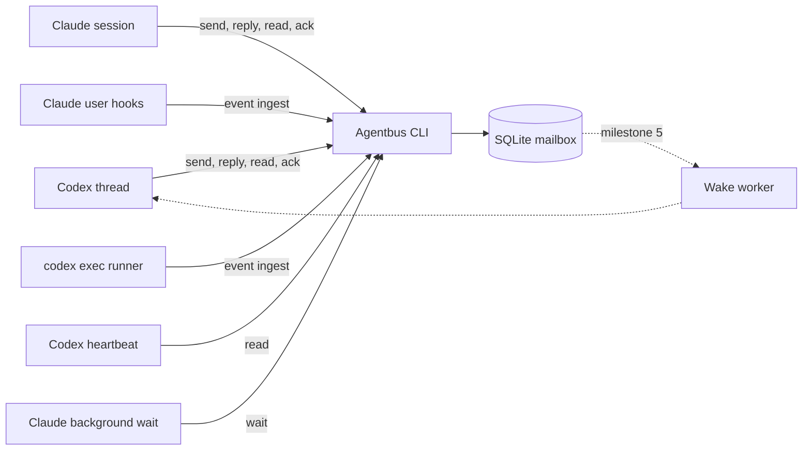

# Agentbus implementation plan

Status: proposed design, revised on 2026-09-30 for bidirectional delegation; implementation has not started.

Agentbus is a local CLI for communication between agent sessions. It supports delegation in both directions: a Codex thread delegates work to a Claude Code session, and a Claude Code session delegates work to a Codex thread. In each case the parent receives progress, questions and the result in its original conversation. The mailbox is provider-agnostic; provider adapters handle observation and wake-up.

Deliver in order of certainty: durable messaging, then worker result capture, then end-to-end delegation in both directions, and only then an automatic Codex wake adapter. Storing a message, requesting a new turn, acknowledging a message and completing a task remain separate events.

## Initial scope and decisions

| Decision | Initial implementation |
| --- | --- |
| Directory | `~/dev/agentbus`; `~/dev` is a symlink to `/workspace` |
| Command | `agentbus` |
| Package | `@vforsh/agentbus` (free on npm as of 2026-09-30); repository `vforsh/agentbus`, private |
| Runtime | Latest stable Bun at implementation time, latest stable TypeScript; Bun tooling throughout |
| Dependencies | Commander for arguments, Zod for boundary validation, Picocolors for human output |
| Storage | SQLite through `bun:sqlite`, rollback journal; SQL migrations and prepared statements |
| Platforms | macOS first; keep the mailbox portable to Linux |
| Deployment | Local checkout and `bun link` after implementation passes its gates |
| Directions | Codex→Claude and Claude→Codex in the first release; same-provider pairs are allowed by the protocol but not verified |
| Launching | The existing skills `codex-to-claude` and `claude-to-codex` remain the launchers and call the same Agentbus steps |
| Process model | Short-lived CLI processes, Claude hooks and the existing `codex exec` runner; no daemon or long-running worker unless a verified wake adapter ships |
| Trust boundary | One OS user on one host; session identities are routing labels, not authenticated principals |
| Verification | Integration, process-level and end-to-end checks; no unit tests or unit-test targets |

The first release supports one recipient per message and text payloads. Cross-host routing, remote authentication, a web UI, file synchronization, retention/pruning and automatic task execution are later extensions. Agentbus supplies identity, correlation, result capture and parent wake-up; the launcher skills keep model, permission and Desktop-handoff logic.

## Roles and paths

Every delegation has a **parent** (the requester) and a **worker** (the recipient of the request). The provider of each role determines how events are observed and how the other side is woken:

| | Claude | Codex |
| --- | --- | --- |
| **As worker: launched by** | `codex-to-claude` → `claude --bg`, later handed to Claude Desktop | `claude-to-codex` → detached runner around `codex exec` |
| **As worker: observed through** | User-level Claude hooks, across the Desktop handoff | The runner, while `codex exec` owns the thread |
| **As worker: follow-up delivery** | Live session: in-turn wait or background wait | In-turn wait, or the parent resumes the thread with `codex exec resume` |
| **As parent: woken by** | A background `agentbus wait`, which re-invokes the session | A heartbeat on the original chat; automatic wake is milestone 5 |
| **As parent: identity** | `CLAUDE_CODE_SESSION_ID` in Desktop sessions, otherwise explicit | `CODEX_THREAD_ID` |

Tracking a Codex worker is required only while `codex exec` owns it. Once the user opens the thread in Codex Desktop, Desktop owns it: explicit mailbox replies still work, and lifecycle observation becomes best effort (optional Codex hooks, milestone 6).

## Acceptance criteria

First release:

1. Two independent processes can register sessions, exchange a request and reply, and acknowledge messages through the installed CLI.
2. A committed message survives sender exit, reader interruption and a subsequent CLI process reopening the database.
3. Repeating a send with the same sender and idempotency key returns the existing message; changing its payload produces a conflict.
4. Reading or waiting does not consume a message. It remains pending until its recipient explicitly acknowledges it. A cursor-based wait does not return messages the caller has already seen, so it never spins.
5. Worker permission prompts, turn failures and normal turn ends produce distinct observer notices. Finishing a turn never means the task succeeded; only a worker-authored `result` carries an outcome.
6. When a delegated Claude turn finishes, the parent's inbox contains Claude's final response with no Agentbus process running other than the hook, including after the background owner has been released to Desktop.
7. When a delegated `codex exec` run finishes or fails, the parent's inbox contains Codex's final message or the failure, reported by the runner.
8. Later turns that were not started for the delegation are not attributed to it: a manual Claude prompt, or a Codex turn outside the runner.
9. A Codex parent collects the result after its initial turn has ended, through a heartbeat or a verified wake adapter. A missing adapter leaves the message available and reports the missing capability.
10. A Claude parent is re-invoked by its background wait when a question, result or notice arrives, without user input. Answering a Codex worker's question resumes the same thread ID without a fork, and is refused while the run is active or after Desktop may have taken the thread.
11. Hooks exit 0 quickly and write nothing for unregistered sessions or when Agentbus is unavailable, for example while the external volume holding the checkout is unmounted.
12. Help, diagnostics and JSON errors are useful without exposing payload bodies in routine logs.

Wake adapter, required only if milestone 5 ships one:

13. A wake attempt reports its actual stage: pending, accepted, unsupported, failed or uncertain. It never claims the model read a message based only on provider acceptance.
14. Killing and restarting a wake worker cannot silently drop a wake or cause two workers to dispatch the same wake.

## Architecture



Use three layers:

- **Mailbox:** sessions, immutable messages, acknowledgements, delegations and normalized observations. It knows nothing about providers beyond identity formats.
- **Provider adapters:** Claude hook ingestion and on-demand `claude agents` probing; ingestion of Codex runner events; later, wake dispatch through verified interfaces only.
- **Agent workflow:** one consumer skill covers both roles: when to read, reply and acknowledge, which task scope is authorized, how to wait as a parent, and how to act on another agent's result.

The mailbox must work with provider adapters disabled. Core commands neither launch models nor require a running daemon. Adapters must not edit another product's database, inject keystrokes, or treat terminal redraws as a message protocol.

### Sessions and addressing

Each registered session has an internal UUID, provider, native identifier, display name, canonical project directory and adapter binding. Provider values are `codex`, `claude` and `generic`, plus the reserved `system` provider. The initial migration creates `system:observer`; users cannot register `system` sessions.

Accept either an internal UUID or `provider:<native-id>` as an address. Names are display metadata, not routing addresses. Resolve one exact match; reject ambiguity and unknown recipients. Native IDs are full lowercase UUIDs; the short IDs printed by `claude --bg` are CLI handles, not identities.

Registration is idempotent on `(provider, external_id)` within this host's store. `--cwd` defaults to the current directory. Preserve the supplied directory for display and its resolved real path for comparison, since `~/dev` resolves to `/workspace`. A changed backend binding requires an explicit update and revalidation.

**Pending workers.** A worker's native ID is unknown until it starts, and it may act before the launcher reads that ID back. Both launchers therefore address the worker by an internal UUID from the start:

1. `session register --provider <claude|codex> --pending` creates a session with an internal UUID and no native ID.
2. The launcher sends the request to that internal UUID. The worker prompt carries the request token and the worker's address.
3. The native ID is bound once known:
   - Claude: `claude --bg --session-id <uuid>` silently ignores the flag. The first `UserPromptSubmit` from an unregistered session whose prompt contains the token of an open delegation with a pending worker claims it in one transaction. The launcher then confirms with `session bind`, using the UUID from `claude agents --all --json`.
   - Codex: the runner reads `thread_id` from the `thread.started` event of `codex exec --json` and runs `session bind`. No hook is involved.
4. `session bind` succeeds when the binding already matches and fails with a conflict when it differs.

A pending session never matches unrelated sessions, because claiming requires the exact token. Delivery works before binding: messages address the internal UUID.

**Caller resolution**, first match wins:

1. `--as <address>`.
2. `AGENTBUS_SESSION_ID`.
3. Native session environment: `CLAUDE_CODE_SESSION_ID` maps to `claude:<id>`, and `CODEX_THREAD_ID` maps to `codex:<id>`. Ignore `CLAUDE_CODE_HOST_SESSION_ID`, which identifies the Desktop host.

Native detection refuses to guess when markers from more than one provider are present. This happens in practice: a `codex exec` started from Claude inherits the parent's `CLAUDE_CODE_SESSION_ID` next to its own `CODEX_THREAD_ID`. Workers resolve identity as follows:

- **Codex worker:** the runner sets `AGENTBUS_SESSION_ID=<worker-id>`, which `codex exec` passes to tool shells, and removes the inherited `CLAUDE_CODE_SESSION_ID` from the worker environment.
- **Claude worker:** `claude --bg` passes neither the launcher's environment nor `CLAUDE_CODE_SESSION_ID` to its Bash tool, so it uses the explicit `--as` from its packet.

Handoff packets always state the worker's address, so a resumed or relaunched worker has it regardless of environment. `whoami` prints the resolved address, its source and registration state. Sending, replying, acknowledging and closing require a registered caller; registration, `whoami` and diagnostics do not.

### Message contract

Use a versioned envelope with these fields:

| Field | Meaning |
| --- | --- |
| `schemaVersion` | Envelope version, initially `1` |
| `id` | Random UUID; stable across retries |
| `sequence` | Database insertion order; JSON integer |
| `from`, `to` | Internal session UUIDs |
| `type` | `message`, `request`, `progress`, `question`, `result` or `notice` |
| `body` | UTF-8 text, copied into SQLite rather than retained only as a file path |
| `createdAt` | UTC timestamp |
| `correlationId` | Root request ID; new requests default to their own message ID |
| `inReplyTo` | Optional parent message ID |
| `idempotencyKey` | Optional caller-supplied retry key, unique per sender |
| `outcome` | For `result` only: `success`, `blocked`, `failed` or `unknown` |
| `notice` | For `notice` only: `{kind, observationId, provider}`; kind is `turn_finished`, `turn_failed` or `permission_request` |
| `acknowledgedAt` | Derived from acknowledgements; nullable; not part of the idempotency hash |

Authorship rules make evidence structural rather than a naming convention:

- `result` is authored by the worker and is the only type that carries an outcome. A failed task is `result` with `outcome: failed`; there is no separate error type.
- `notice` is authored only by `system:observer`. Its body is the relevant excerpt; for `turn_finished`, that is the worker's last assistant message. Notices cannot be replied to.

`reply` derives the recipient and correlation ID from the original message. Only the original recipient can reply through this operation. Keep raw provider payloads in observations, never in ordinary messages.

Sending a `request` opens a delegation, keyed by the request message ID, in the same transaction. It records the parent, worker and state. It closes when the worker replies with `result` or when the parent runs `close`. It does **not** close when a provider process ends: `claude stop` during Desktop handoff and every `codex exec` exit both fire `SessionEnd`, while the conversation continues.

Use a proposed 1 MiB body limit to accommodate long handoff packets while bounding memory and database growth. Reject invalid UTF-8, unsupported envelope versions and excess input with actionable errors. Referenced project artifacts remain ordinary paths; copying attachments is a later feature.

### Delivery and retry semantics

Messages are committed before any success receipt is printed. `read` and `wait` return unacknowledged messages repeatedly until `ack`; this is intentional at-least-once delivery. Agentbus does not promise exactly-once task execution.

Scope idempotency keys to the sender. Compare a canonical hash of recipient, body, type, correlation, reply target and outcome on retry. Reusing a key for a different request fails. An unkeyed send creates a fresh message, so automated producers must supply stable keys.

Acknowledgements are idempotent and recipient-scoped. They mean the receiving workflow accepted responsibility for a message. They do not prove a task succeeded or even that a provider started a model turn. Support multiple acknowledgements atomically; validate the complete set first.

Every `read` and `wait` receipt includes `cursor`, the highest returned `sequence`. `--after <cursor>` limits results to newer messages. Without it, `wait` would return immediately forever whenever the caller deliberately leaves a message pending. Cursors navigate history; they never acknowledge earlier messages. Receipt state remains authoritative when recovering interrupted processing.

### Observation and task outcome

Keep these independent:

- Session activity: `running`, `awaiting_input`, `idle`, `stopped` or `unknown`.
- Native owner: `background`, `desktop`, `exec`, `interactive` or `unknown`.
- Observed lifecycle event: `turn_started`, `turn_finished`, `turn_failed`, `permission_request` or `owner_released`.
- Explicit request outcome: `success`, `blocked`, `failed` or `unknown`.

Activity and owner come only from an explicit `status --probe` or the latest runner event, and are never cached as truth. Lifecycle events come from Claude hooks and the Codex runner; each observation records its source (`claude-hook` or `codex-runner`), timestamp, delegation and native turn ID when available. `owner_released` is recorded but posts no notice. Outcome comes only from a worker-authored `result`. Missing process metadata is unknown state, not successful completion.

The observation event ID is derived from `(provider, session, turn ID, event)` when a turn ID exists, and is random otherwise. Duplicate reports of the same turn therefore ingest once, which also covers optional Codex hooks later reporting a turn the runner already reported.

### Delegated turn binding

Each launcher appends a machine token, `agentbus-request: <message-id>`, and reply instructions to the worker prompt.

**Claude worker.** `UserPromptSubmit` and `Stop` both carry `prompt_id`, which gives exact turn identity. For a registered Claude session with an open delegation:

- `UserPromptSubmit` containing the token binds its `prompt_id` to that delegation.
- A background task completing re-invokes the session through `UserPromptSubmit` with a prompt beginning `<task-notification>`. Treat that as a continuation: its `prompt_id` stays bound.
- Any other prompt, such as a manual Desktop follow-up, unbinds the delegation, so later turns are never attributed to the request.
- `Stop` for a bound `prompt_id` records `turn_finished` and posts a notice containing `last_assistant_message` to the parent. `Stop` also lists the session's `background_tasks`; the notice states whether any are still running, since Claude will then take another turn. Each bound turn posts its own notice, and the latest one is the fallback response.
- `StopFailure` posts `turn_failed`. `PermissionRequest` posts `permission_request` as a need for user input; the hook never answers it. `SessionEnd` records `owner_released` only.

**Codex worker.** Binding is structural: a delegation is bound to the `codex exec` runs that its launcher starts, meaning the initial run and parent-initiated resumes, each carrying the token. When `codex exec` exits, the runner ingests one event:

- `turn_finished` with the contents of `last-message.md`, when the run completed.
- `turn_failed` with the error summary, when the run failed or produced no final message.

`codex exec` runs with `approval_policy=never`, so a Codex worker never raises `permission_request`. Turns the user starts in Codex Desktop have no runner, so they are never attributed. If the runner itself dies, no event arrives, and the parent's wait timeout plus `status.sh` report the run as `lost`.

In both cases a worker `result` closes the delegation; later events for that session post nothing. Tool activity is not captured; workers report progress with explicit `progress` replies.

## Storage and concurrency

Respect XDG paths:

- Config: `${XDG_CONFIG_HOME:-~/.config}/agentbus/config.json`.
- State: `${XDG_STATE_HOME:-~/.local/state}/agentbus/`.
- Database: `<state-dir>/agentbus.sqlite3`.
- Event spool and adapter logs: subdirectories of the state directory.

Use private directory and file modes (`0700` and `0600`). The state database lives on the internal disk, independent of the external volume holding the checkout. Project symlinks do not determine its location.

Tables by milestone:

| Table | Milestone | Responsibility |
| --- | --- | --- |
| `schema_migrations` | 2 | Applied migration versions |
| `sessions` | 2 | Provider identities, pending state, project paths and adapter bindings; seeded with `system:observer` |
| `messages` | 2 | Immutable payloads and correlation links |
| `acknowledgements` | 2 | Recipient acceptance; unique per message and recipient |
| `delegations` | 2 | Parent/worker binding, currently bound turn, open or closed state |
| `observations` | 3 | Normalized provider evidence with deterministic event IDs |
| `wake_outbox`, `wake_attempts`, `worker_leases` | 5 | Wake dispatch state, only if an adapter ships |

Add foreign keys, uniqueness constraints and indexes for recipient inbox scans by sequence, sender retry keys, request correlation and open delegations per worker. Keep migrations transactional and serialized. `init` creates or migrates the store; other commands refuse an older or newer schema with a remediation hint, and event ingestion spools instead. A command must never silently downgrade or repair a database.

Configure every connection with `foreign_keys=ON` (SQLite applies it per connection), `journal_mode=DELETE`, `synchronous=FULL` and a busy timeout of 5 seconds for commands and 1 second for hooks. Use short write transactions; never hold one while polling, sleeping or running a subprocess. Commit a message and its delegation row, and later its wake-outbox row, in the same transaction.

`wait` polls outside transactions every 250 ms and checks `PRAGMA data_version` first, which changes only when another connection commits, so an idle wait issues no inbox queries. Both behaviors were verified under `bun:sqlite` in `DELETE` mode: `foreign_keys` defaults to 0, and `data_version` changed for the other connection but not for the committing one.

### Journal mode decision

On macOS, Bun loads the system SQLite by default: both Bun `1.3.8` and Bun `1.4.2` report SQLite `3.43.2` on this machine. Homebrew SQLite `3.53.4` is installed and loads through `Database.setCustomSQLite()`, but it would make the runtime depend on Homebrew. SQLite documents a WAL-reset race affecting concurrent connections in releases through `3.51.2`, fixed in `3.51.3` with backports including `3.44.6` and `3.50.7`. [SQLite WAL documentation](https://www.sqlite.org/wal.html#walreset), [Bun SQLite documentation](https://bun.sh/docs/runtime/sqlite).

Use rollback journal mode (`DELETE`) with `synchronous=FULL`, and offer no journal option in v1. This is a local mailbox with small, infrequent writes; correctness takes priority over throughput. If measurements later justify WAL, load a verified fixed SQLite through `Database.setCustomSQLite()` rather than trusting the system library, select the mode only in `init`, and never delete sidecar files manually. Recheck the SQLite version after the Bun upgrade.

## CLI specification

```text
agentbus init
agentbus whoami
agentbus session register|bind|list|show|update
agentbus send <recipient> --file <path|->
agentbus reply <message-id> --file <path|->
agentbus read [--all] [--after <seq>] [--from <addr>] [--type <type>] [--correlation <id>] [--limit <n>]
agentbus wait [--after <seq>] [--timeout <duration>] [same filters as read]
agentbus ack <message-id...>
agentbus close <request-id>
agentbus status [<session>] [--probe]
agentbus event ingest --provider <claude|codex> --source <hook|runner> [--file <path|->]
agentbus event drain
agentbus hooks claude print|install|uninstall|status
agentbus config|cfg list|ls|path|get|set|unset|import|export
agentbus doctor|check
agentbus skill
agentbus completion <fish|zsh|bash>
```

Milestone 5 adds `send --wake`, `wake <session> --message <id>` and `worker run|list|stop` only if the Codex spike passes. Milestone 6 may add `hooks codex`. Commands not yet implemented must not appear as successful placeholders.

### Commands and flags

| Command | Inputs and behavior |
| --- | --- |
| `init` | Create the state directory and schema, or migrate forward. Idempotent. |
| `whoami` | Print the resolved caller address, its source (flag, environment or native) and registration state. |
| `session register` | Require `--provider` and either `--external-id` or `--pending`; optional `--cwd` (default: current directory) and `--name`. Return the internal ID and, once known, the provider address. |
| `session bind` | Set the native ID of a pending session, or confirm an existing token claim; a different existing ID is a conflict. |
| `session list/show` | Read session metadata; never probe providers. |
| `session update` | Update display metadata or explicit provider binding; provider and native identity are immutable. |
| `send` | Require `--file`; optional `--type`, `--key` and `--outcome`. Default type `message`. A `request` opens a delegation. |
| `reply` | Same body, type and retry flags as `send`; derive destination and correlation. |
| `read` | Default: caller's unacknowledged inbox in ascending sequence, limit 50. `--all` includes acknowledged history. Filters combine. Returns `cursor`. |
| `wait` | Return immediately when matching pending messages exist after the cursor; otherwise poll until the timeout. Never acknowledges. |
| `ack` | Mark the caller's selected messages accepted; repeated acknowledgement is a success. |
| `close` | Parent closes an open delegation without a result, for an abandoned or lost task. |
| `status` | Mailbox counts, open delegations with their latest notice and runner state, and spool backlog. `--probe` adds live Claude activity and owner from `claude agents --all --json`; without it, no provider subprocess runs. |
| `event ingest` | Entry point for Claude hooks (`--source hook`, payload on stdin) and the Codex runner (`--source runner`, normalized event file). See Provider adapters. |
| `event drain` | Ingest spooled events. `read`, `wait` and `status` also drain before reading. |
| `hooks claude` | `print` emits the settings snippet. `install` merges it into `~/.claude/settings.json` idempotently, preserves existing hook entries and writes a backup; supports `--dry-run`. `status` verifies the entries. Only this explicit command changes provider settings. |
| `config` | Support non-interactive setup, batched set/get/unset, stdin JSON import and JSON export. |
| `doctor` | Read-only readiness checks with remediation, including hook installation, spool backlog and schema version; never start a daemon, log in, drain the spool or rewrite provider settings. |
| `skill` | Print the real repository skill installation URL after the repository exists; fail clearly while its URL is unconfigured. |
| `completion` | Print the completion script to stdout; installation remains explicit. |

Global options: `--as`, `--config`, `--state-dir`, `--json`, `--plain`, `-q/--quiet`, `-v/--verbose`, `--no-color`, `--no-input`, `-h/--help` and `--version`. `--json` and `--plain` are mutually exclusive; quiet mode must not suppress requested machine receipts. Help and version require neither initialization nor provider access.

Accept positive durations with `ms`, `s`, `m` or `h`. `wait` defaults to 60 seconds and accepts at most 24 hours. Short waits let an agent report between checks; long waits let a Claude background command re-invoke its session when a message arrives. Provider subprocess timeouts are separate from wait timeouts. Limits default to 50 and cap at 1,000 records.

All body input comes from a file or `--file -`; do not put handoff packets in argv. Call provider binaries with argument arrays, never generated shell command strings. `--dry-run` on `send`, `reply` and `hooks claude install` validates and describes the action without writing.

### Output and exit codes

Human output is concise, with payload text only on commands intended to read it. `--plain` returns stable tab-separated fields. `--json` produces one versioned object per invocation, including failures; logs and diagnostics remain on stderr.

Example request receipt:

```json
{
  "schemaVersion": 1,
  "ok": true,
  "data": {
    "messageId": "<uuid>",
    "sequence": 42,
    "stored": true,
    "duplicate": false,
    "delegation": { "state": "open" },
    "returnPath": "background_wait"
  }
}
```

`delegation` is null for non-request types. `returnPath` tells the parent how replies will reach it, derived from the parent's provider: `heartbeat` for Codex (until a verified adapter covers the binding, then `adapter`), `background_wait` for Claude. The parent skill acts on it instead of guessing.

Errors use `{schemaVersion, ok: false, error: {code, message, exitCode, details}}`. Details contain IDs and remediation, not routine payload dumps. Provider acceptance is reported as `accepted`, never `read`.

| Exit | Meaning |
| --- | --- |
| `0` | Operation succeeded; mailbox persistence is sufficient for `send` |
| `1` | Unexpected failure, or failing readiness checks |
| `2` | Invalid usage or invalid input |
| `3` | Wait timed out; return an empty message list with `timedOut: true` |
| `4` | Session, message or configured resource not found |
| `5` | Conflicting retry key, ambiguous identity or incompatible ownership |
| `6` | Database contention exhausted its deadline |
| `7` | Reserved for milestone 5: explicit wake unsupported, unavailable, failed or uncertain |
| `130` | Interrupted by Ctrl-C |

### Configuration

Precedence: explicit flags, `AGENTBUS_*` environment values, selected user config, defaults. V1 has no automatically discovered project configuration. Never repurpose `HOME` or `CODEX_HOME`.

Environment variables are `AGENTBUS_SESSION_ID`, `AGENTBUS_CONFIG` and `AGENTBUS_STATE_DIR`, plus standard XDG and color variables. Native provider session variables are read only for caller resolution. Reject unknown configuration keys and report the resolved paths.

Store provider executable paths in config; add wake strategy names in milestone 5. Backend bindings belong to session records, not a global current-project setting. Credentials are unnecessary for the same-user local MVP; any later secret settings must accept stdin or a credential reference and redact normal listings.

## Provider adapters

### Claude hooks

Install hooks in user settings (`~/.claude/settings.json`), which already contains the user's own hooks, so CLI background sessions and Desktop-resumed sessions load the same entries. Do not rely on `--settings` passed only to the initial process. Milestone 3 verifies both owners.

Subscribe only to low-frequency events: `SessionStart`, `UserPromptSubmit`, `PermissionRequest`, `Stop`, `StopFailure` and `SessionEnd`. Skip tool-use and `SubagentStop` events: user hooks run in every Claude session on the machine, including unrelated ones, and progress belongs in explicit replies.

Hook command contract:

- Guard the command so a missing binary is a silent no-op. The `bun link` target lives on an external volume and disappears when it is unmounted. The command always exits 0; exit code 2 would block Claude, and on `Stop` would keep the turn running.
- Print nothing to stdout. Output from `UserPromptSubmit` and `SessionStart` becomes model context, and JSON output can return permission or stop decisions.
- For an unregistered `session_id`, perform one indexed lookup and exit without writing anything. The exception is a `UserPromptSubmit` whose prompt contains a request token, which may claim a pending session. The token check is an in-memory string match, done before any database access. A cold Bun start plus a read-only SQLite lookup measured 10–20 ms; target under 50 ms.
- For a registered session, commit the observation and any notice in one transaction within the hook budget.
- If the commit cannot complete (store busy, missing or on another schema), write the normalized event to `<state-dir>/spool/` using a temp file and atomic rename. The spool file keeps the event ID, so re-ingestion is idempotent. Drain removes a file only after its commit and ignores incomplete temp files.

`Stop.last_assistant_message` supplies the fallback final response. `Stop` can coexist with active background tasks, and API failures use `StopFailure`; handlers preserve those distinctions. [Claude hooks reference](https://code.claude.com/docs/en/hooks#stop). Explicit `result` replies take precedence over fallback text. Reading persisted conversation history through the Agent SDK's `get_session_messages()` remains an optional later feature. [Anthropic session browser example](https://platform.claude.com/cookbook/claude-agent-sdk-05-building-a-session-browser).

Optional in milestone 3: for a registered session with pending mail, `SessionStart` and `UserPromptSubmit` add one line of context listing counts and message IDs, never bodies. This is the only permitted hook output.

### Claude session probing and Desktop handoff

`claude agents --all --json` rows expose at least `id`, `sessionId`, `kind`, `state`, `name`, `cwd` and `startedAt`; live rows add `pid` and `status`, which the launcher's `desktop.sh` uses. The short `id` is the first 8 characters of `sessionId`. Observed states include `working`, `done` and `stopped`. Validate rows with Zod, match the exact `sessionId`, and treat absent fields or rows as unknown.

The `codex-to-claude` Desktop helper polls every 5 seconds, waits for `state=done` and an idle status, stops the background owner and opens the same session through `claude://resume`. It remains the only handoff controller. Agentbus needs no handoff logic: user-level hooks keep firing after the transfer and are filtered by UUID, and `status --probe` reports the observed owner.

**Existing launcher defect.** After any turn in which a background command ran, `state` stays `working` with `status: idle` indefinitely. A control session without background commands reached `done`. The helper's `state=done` condition therefore stalls for its full 24-hour deadline whenever the delegated work used a background command, and an armed Agentbus wait always is one. Milestone 4 fixes the helper: treat the session as ready for handoff when `status` is idle and the latest `Stop` observation reports no running `background_tasks`, not when `state` is `done`.

### Codex runner events

`claude-to-codex` already starts a detached runner that owns one `codex exec --json` run, names the thread afterwards and writes `state.json` and `last-message.md`. Milestone 4 extends it without changing its ownership rules:

1. Before starting `codex exec`, set `AGENTBUS_SESSION_ID=<worker-id>` and remove `CLAUDE_CODE_SESSION_ID` from the child environment.
2. On `thread.started`, run `agentbus session bind <worker-id> --external-id <thread_id>`. A resume run keeps the bound thread ID and skips this step.
3. After `codex exec` exits and `state.json` is final, write a normalized event file and run `agentbus event ingest --provider codex --source runner --file <event>`. The event holds the thread ID, the run's turn ID when available, `completed` or `failed`, the final message and an error summary.
4. Agentbus failures never change the runner's own outcome: a failed ingest spools, and the runner still writes `state.json`.

The runner is the authoritative observer while `codex exec` owns the thread, which is the tracking scope chosen for v1. Codex also supports Claude-compatible hooks: under `codex exec` they report `session_id` (the thread ID), `turn_id`, `prompt` and `last_assistant_message`. But non-managed hooks run only after the user trusts their exact hash in `/hooks`, so hooks are not required for v1. They are optional in milestone 6, for best-effort coverage of turns in Codex Desktop. [Codex hooks reference](https://developers.openai.com/codex/hooks).

### Return paths

**Claude parent: background wait.** After sending a request, the parent skill arms `agentbus wait --correlation <request-id> --after <cursor> --timeout 30m` as a Claude Code background command and ends its turn. Claude Code re-invokes the session when the wait exits; this was verified in a `--bg` session, where a background `sleep 25` produced a `<task-notification>` prompt and a new turn. On re-invocation the parent:

- On a message: reads it, acts, acknowledges, and re-arms the wait until the delegation's `result` is acknowledged or it closes the delegation.
- On a timeout (exit 3): checks worker state (`status`, and `status.sh <runDir>` for a Codex worker), reports only real changes, and re-arms. The timeout is the safety net for a runner that died without an event; 30 minutes bounds the number of idle re-invocations.

A background wait dies with its owning process. A Claude parent that is itself a background worker (Codex→Claude→Codex) keeps its session busy while the wait is armed, so its own Desktop handoff waits until the nested delegation finishes. That is intended, per the fixed readiness rule.

**Codex parent: heartbeat.** The parent skill creates a heartbeat on the original chat through the app's automation tool after sending the request. Each wake runs `agentbus read --correlation <request-id> --after <cursor> --json` and reports only meaningful changes: a question, a result or a blocking notice. The skill deletes the heartbeat after acknowledging the delegation's `result` or closing it. The CLI cannot invoke that app-only tool itself. [Thread automation behavior](https://learn.chatgpt.com/docs/changelog). Automatic wake-up of a Codex parent is milestone 5.

### Follow-ups to workers

A follow-up is always first written to the mailbox (`reply` to the worker's question), so the durable record exists before any delivery attempt.

**Claude worker.** V1 supports collection by a live session. Within a turn, the worker calls `wait --after <cursor>` in bounded loops. Across turns, it asks with `reply --type question`, arms a background wait like a Claude parent does, and ends its turn. Whether a wait armed in a Desktop-owned session behaves the same is a milestone 3 check. Resuming a stopped Claude session can be added only after verifying that no live owner exists and keeping the returned native ID: the CLI can copy a conversation resumed while a live owner remains, and silent copies are unacceptable. A local MCP Channel is the later route for pushing into a running session. [Claude Channels reference](https://code.claude.com/docs/en/channels-reference).

**Codex worker.** Within a run, the worker may call bounded `wait --after <cursor>` before ending its turn. Once the run has ended with a question, the Claude parent delivers the answer by resuming the same thread through the launcher: `spawn.sh --resume <threadId> -f followup.md`. `followup.md` carries the token, the worker address and the answer's message ID. Preconditions:

- The runner state is `completed` or `failed`, never `running`.
- Desktop has not been asked to open the thread (`desktopOpenRequested: false`). If the user may have opened the `desktopLink`, the parent asks the user before resuming, because Desktop keeps its own copy and the histories would diverge.

The resumed run must report the same `threadId`; a different ID is a fork, and the parent reports it instead of continuing. Agentbus never resumes on its own in v1.

### Codex wake adapter (milestone 5)

This concerns waking a Codex **parent** chat without a heartbeat. The installed CLI `0.157.1` exposes `codex queue --thread <id> --message <text>` with an optional `--remote <addr>` app-server endpoint (`ws://`, `wss://` or `unix://PATH`). `codex agents` browses sessions on a "shared local app-server daemon", and `codex remote-control start|stop|pair` manages that daemon. The standard daemon endpoint returned `Connection refused` when checked. This establishes an interface candidate, not working delivery into the current Desktop chat. Run a bounded spike against a disposable Codex chat to establish:

1. Which backend owns the chat and whether the CLI can address that same backend.
2. Behavior when the chat is working, idle and not displayed.
3. Whether acceptance starts or queues a turn, and how to verify that without creating a fork.
4. Behavior after disconnect/reconnect, unknown receipt and repeated dispatch.
5. Whether a Codex background terminal re-invokes the chat when it exits, equivalent to the Claude background-wait pattern; that would avoid a worker entirely.

If the spike passes, send a small notice containing the message ID and instructions to read the mailbox; keep the body in the store. Do not start a second daemon as a guessed workaround for an inaccessible Desktop backend. An App Server adapter is another candidate where the owning backend offers a supported connection; `turn/start` and `turn/steer` have different lifecycle behavior, so do not guess which one is safe for an existing turn. [Codex App Server reference](https://learn.chatgpt.com/docs/app-server).

Use database leases with a random owner token and increasing fencing generation. Proposed defaults: renew every 10 seconds, expire after 30 seconds and bound each provider command to 10 seconds; verify them under machine sleep and resume. Recheck the lease before dispatch and before committing a receipt. A stale worker that wakes after its lease expired exits without changing the new owner's state. Never hold a transaction across a provider operation.

Wake states are `pending`, `dispatching`, `accepted`, `unsupported`, `failed` and `uncertain`. Retry only failures known to occur before provider acceptance. If the process dies after dispatch and before saving the receipt, mark the attempt uncertain unless the provider supplies an idempotency mechanism or verifiable receipt. Never automatically repeat an ambiguous model-start operation. Request a wake only for attention events: `result`, `question`, and `turn_failed` or `permission_request` notices.

## Example agent workflows

Commands below illustrate the intended interface. Replace placeholders with real IDs and existing paths.

### Codex parent, Claude worker

```bash
agentbus init --json

# Codex parent, through codex-to-claude; caller resolves from CODEX_THREAD_ID
agentbus session register --provider codex --external-id "$CODEX_THREAD_ID" --name planner --json
agentbus session register --provider claude --pending \
  --cwd /Users/example/dev/project --name implementer --json      # -> <worker-id>
agentbus send <worker-id> --type request --key task-001 \
  --file "$handoff_dir/request.md" --json                        # -> <request-id>, returnPath: heartbeat
# spawn.sh appends "agentbus-request: <request-id>", "--as <worker-id>" and reply
# instructions to the same packet, starts claude --bg, then confirms the claim:
agentbus session bind <worker-id> --external-id <claude-session-uuid> --json

# Claude worker; explicit --as, since --bg tool shells carry no session variable
agentbus --as <worker-id> read --type request --json
agentbus --as <worker-id> ack <request-id> --json
agentbus --as <worker-id> reply <request-id> --type result --outcome success \
  --key task-001-result --file "$handoff_dir/result.md" --json

# Codex heartbeat wake
agentbus read --correlation <request-id> --after <cursor> --json
agentbus ack <result-message-id> --json
```

### Claude parent, Codex worker

```bash
# Claude parent in a Desktop session, through claude-to-codex; caller resolves from CLAUDE_CODE_SESSION_ID
agentbus session register --provider claude --external-id "$CLAUDE_CODE_SESSION_ID" --name lead --json
agentbus session register --provider codex --pending \
  --cwd /Users/example/dev/project --name executor --json         # -> <worker-id>
agentbus send <worker-id> --type request --key task-002 \
  --file "$run_dir/request.md" --json                            # -> <request-id>, returnPath: background_wait
# spawn.sh appends the token, worker address and reply instructions; the runner
# sets AGENTBUS_SESSION_ID=<worker-id> and binds the thread on thread.started.

# Claude parent arms the wait as a background command, then ends its turn
agentbus wait --correlation <request-id> --after <cursor> --timeout 30m --json

# Codex worker; caller resolves from AGENTBUS_SESSION_ID
agentbus ack <request-id> --json
agentbus reply <request-id> --type question --file - --json <<'EOF'
Which config file should win when both exist?
EOF

# Claude parent, re-invoked by the wait: answer, then resume the same thread
agentbus reply <question-id> --file "$run_dir/answer.md" --json   # -> <answer-id>
~/.claude/skills/claude-to-codex/scripts/spawn.sh --resume <thread-id> \
  -f "$run_dir/followup.md" -C /Users/example/dev/project           # followup names <answer-id>
agentbus wait --correlation <request-id> --after <cursor> --timeout 30m --json
```

The same packet file serves as the prompt and the request body; the mailbox copy is the durable record. `--file -` also accepts piped text. An answer uses `reply` on the question, preserving correlation. The worker's acknowledgement and final result are separate messages and receipts, so a stopped worker does not erase evidence of outstanding work.

## Repository structure

```text
bin/agentbus
src/index.ts
src/cli/program.ts
src/cli/commands/
src/config/
src/protocol/
src/store/migrations/
src/store/
src/services/
src/adapters/claude/     # hooks, agents probe
src/adapters/codex/      # runner events; milestone 5 wake
src/worker/              # milestone 5
tests/integration/
tests/e2e/
scripts/
skill/agentbus/SKILL.md
README.md
PLAN.md
package.json
tsconfig.json
bun.lock
```

Commands orchestrate domain operations; SQL belongs to store modules, provider subprocesses to adapters, and workflow state to services. Start with concrete functions and types; extract shared adapter interfaces only when both providers need them. Normalized observation events are that first shared contract. Keep code files below roughly 1,000 lines.

Use a Bun entrypoint, package `bin` mapping, strict TypeScript and current compatible dependency releases locked at scaffolding time. Add lint/format tooling then and check its maintenance before introducing it. Recheck Commander, Zod and Picocolors versions when implementation starts. [Commander](https://github.com/tj/commander.js), [Zod](https://github.com/colinhacks/zod), [Picocolors](https://github.com/alexeyraspopov/picocolors).

### Bun version policy

Resolve the latest stable Bun from the official release feed when implementation begins; do not use canary or treat the older local binary (`1.3.8`) as the baseline. The stable release on September 30, 2026 is `1.4.2`; re-resolve at scaffolding time. [Official Bun release](https://github.com/oven-sh/bun/releases/tag/bun-v1.4.2).

Update Bun through its existing installation method, then record `bun --version` and `bun --revision`. Pin that version in `packageManager` and CI, set the supported floor in `engines.bun`, and document it in README. Verify the SQLite version separately after the runtime change.

## Implementation milestones

### 1. Scaffold and contracts

- Select the latest stable Bun; record its version, revision and SQLite version.
- Initialize the Bun project; create the binary, strict compiler config, lint setup and command registration.
- Define message, session, observation, output and error schemas; document exit codes and proposed defaults.
- Implement help/version, configuration, read-only diagnostics, `whoami` and completion output.
- Capture provider evidence as fixtures:
  - Claude: `claude --help` and `claude agents --all --json` rows, including a `working`/`idle` row left behind by a background command.
  - Claude: payloads for the six subscribed hook events, including a `<task-notification>` prompt and a `Stop` with running `background_tasks`.
  - Codex: `codex exec --json` event streams for success, failure and resume, the runner's `state.json`, and `codex queue --help`.
- Verify the binary from a temporary working directory with no initialized mailbox; help must still work.

Exit condition: CLI conventions, configuration and validation are usable; diagnostics identify missing state and provider capabilities without changing them.

### 2. Durable mailbox

- Implement migrations, sessions with pending state and the `system:observer` seed, messages, acknowledgements and delegations.
- Implement send/reply/read/wait/ack/close/bind, retry-key conflicts, cursors, `returnPath` and dry-run behavior.
- Commit before printing receipts; handle busy deadlines and Ctrl-C.
- Verify separate OS processes, Unicode bodies, long stdin input, concurrent senders, restart recovery and recipient-scoped acknowledgements.

Exit condition: the mailbox satisfies acceptance criteria 1–4 with provider adapters disabled.

### 3. Worker result capture

- Run the remaining Claude checks first, with disposable sessions: the UUID and `prompt_id` continuity survive Desktop resume; user-level hooks (not `--settings`) fire under both owners; and a background wait armed in a Desktop-owned session re-invokes it.
- Implement `event ingest` for both sources, deterministic event IDs, token claims, the spool and drain, observations, turn binding and notices.
- Implement `hooks claude print|install|uninstall|status`.
- Implement `status --probe` for Claude with strict ID matching and schema validation.
- Drive `--source runner` with recorded `codex exec` fixtures through the public CLI; the live runner integration lands in milestone 4.

Exit condition: acceptance criteria 5–8 and 11 at the adapter level. Claude turn completion, failures and permission prompts reach the parent's inbox with no Agentbus process besides the hook; Codex runner events produce the same notice kinds; outcome remains unknown when only final text exists.

### 4. End-to-end delegation in both directions (first release)

- Write the consumer skill under `skill/agentbus/SKILL.md`: identity, message types, cursors, acknowledgements, outcomes, the parent loop per `returnPath`, the worker role, the question round-trip and recovery.
- Integrate `codex-to-claude`: pending registration, request send, prompt token and `--as`, post-launch `session bind`, and `reply --type result` in place of the ad hoc `result.md` handshake. Fix its handoff readiness rule (idle status and no running background tasks, not `state=done`). Preserve its Desktop ownership rules; its helper remains the only handoff controller.
- Integrate `claude-to-codex`: pending registration, request send, prompt token, runner environment (`AGENTBUS_SESSION_ID`, removal of `CLAUDE_CODE_SESSION_ID`), bind on `thread.started`, and runner event ingestion. Resume keeps the thread ID and refuses to run when the run is active or Desktop may own the thread. `last-message.md` stays as the runner's local record.
- Document both parent lifecycles: the Codex heartbeat, and the Claude background wait with its timeout re-arm.
- Add README installation, doctor/config/hooks examples, protocol contract and a provider support matrix per role.
- Run the full gate, then `bun link`; verify the installed command outside the checkout.

Exit condition: acceptance criteria 9 and 10 with two disposable end-to-end runs, each without a duplicate conversation or competing file edits:

- Codex→Claude: the result returns to the original Codex chat through a heartbeat after that chat's first turn ended.
- Claude→Codex: the parent is re-invoked by its wait, answers one worker question by resuming the same thread ID, and then receives the result.

### 5. Codex wake adapter (conditional)

- Run the backend capability spike before writing production dispatch.
- If it passes, implement the wake outbox, attempt receipts, leases with fencing, uncertain-dispatch handling, `send --wake`, `wake`, `worker run|list|stop` and exit code 7.
- Verify active/idle chats, unavailable adapters, duplicate notices, interrupted dispatch and restart recovery.

Exit condition: acceptance criteria 13–14. If the spike fails, record the evidence, keep the heartbeat as the supported Codex return path and do not ship a worker.

### 6. Optional extensions

- `hooks codex print|install|status` for `~/.codex/hooks.json`, with a documented one-time `/hooks` trust step, for best-effort observation of Codex Desktop turns. It deduplicates against runner events by turn ID.
- Prototype a local Claude MCP Channel with request/reply correlation; verify running-session delivery and channel loading after Desktop transfer.
- Add transcript inspection through SDK read APIs if mailbox notices are insufficient.
- Consider supervised launchd installation only after worker restart behavior is verified and persistent monitoring is requested.

This milestone is outside the first-release acceptance gate.

## Verification and release gate

Use real subprocesses and temporary state directories for mailbox integration checks. Hook fixtures, runner fixtures and fake provider executables enter through the public CLI/process boundary. Do not add unit-test targets or tests that merely mirror helper implementation.

| Scenario | Required evidence |
| --- | --- |
| Concurrent writers/readers | Committed record count, unique IDs, no missing acknowledged records, database integrity check |
| Retry collisions | Same keyed payload returns the same ID; changed payload is rejected |
| Interrupted wait | Exit 130; pending messages remain retrievable |
| Wait cursor | With an already-seen pending message, `wait --after` blocks until a newer message or timeout |
| Process crash after commit | Reopened mailbox contains the committed message |
| Receipt emitted | Corresponding transaction is already committed |
| Wrong recipient | Reading, replying, acknowledging and closing fail without modifying state |
| Authorship | A `notice` from a non-system sender, an `outcome` on a non-result and a reply to a notice are rejected |
| Cursor recovery | Pagination has stable order; advancing a cursor does not erase unacknowledged messages |
| Unregistered hook | Exit 0, empty stdout, no database or spool writes; latency recorded |
| Missing binary | Guarded hook command is a silent no-op with the checkout volume unavailable |
| Spool interruption | Complete spool event survives restart and ingests once; incomplete temp file is not ingested |
| Duplicate event | The same turn reported twice ingests once |
| Turn binding | A tokenless follow-up turn produces no notice for the earlier request; a `<task-notification>` turn stays bound |
| Token claim | Only a prompt with the exact token claims a pending session; a conflicting `session bind` is rejected |
| Owner release | `SessionEnd` from `claude stop` or a `codex exec` exit leaves the delegation open |
| Worker final response | Explicit `result` and observer `turn_finished` notice remain distinguishable for both providers |
| Desktop ownership change (Claude) | Same native UUID; hooks still fire; unrelated subsequent turns are not attributed |
| Runner outcomes (Codex) | Completed run → `turn_finished` with the final message; failed run → `turn_failed`; runner killed → no notice, parent timeout path reports `lost` |
| Codex worker identity | Worker resolves to its internal ID despite the parent's leaked `CLAUDE_CODE_SESSION_ID` |
| Codex resume | Same thread ID after resume; refused while running or after `desktopOpenRequested` |
| Claude parent wake | A background wait re-invokes the parent on a result; a timeout re-arms without user-visible noise |
| No Codex wake strategy | Message remains stored; receipt reports `returnPath: heartbeat` |
| File/stdin input | Quotes, shell syntax, Cyrillic and long text arrive unchanged |
| Help/doctor | No model launch, login, provider config change, spool drain or daemon bootstrap |
| Worker competition (milestone 5) | One lease owner; a stale fenced owner cannot commit receipts |
| Unknown dispatch (milestone 5) | Attempt becomes uncertain; no automatic second model-start request |

The package gate is `bun run lint`, `bun run typecheck`, `bun run test:integration`, `bun run test:e2e`, plus a documented installed-command smoke check. Create these targets during scaffolding. Tests isolate their state and clean up only resources they created. Tests never touch the real `~/.claude/settings.json` or `~/.codex` configuration.

Use disposable provider sessions for live adapter checks. Collect the native IDs, backend binding, command receipts and observed result. Do not stop or resume unrelated existing sessions to make a check pass; archive only Codex test threads created by the check. Report missing provider capabilities as incomplete acceptance criteria rather than a successful mocked end-to-end result.

## Remaining implementation questions

None block the mailbox milestone. Each has a narrow check in the milestone noted:

- Do the session UUID, user-level hooks and `prompt_id` behave the same after Claude Desktop resume? (3)
- Does a background wait armed in a Desktop-owned Claude session re-invoke it? (3)
- Does the `codex exec --json` stream expose a turn ID the runner can report, for deduplication with optional Codex hooks? (1)
- Does `codex exec resume` from the runner keep the thread ID and pass the new environment to tool shells? (4)
- Is `CODEX_THREAD_ID` set in Codex Desktop tool shells, as it is under `codex exec`? (4)
- Can `codex queue`, through the shared app-server daemon or `--remote`, reach the backend that owns the Desktop chat, and what receipt does it expose? (5)

Resolved by design: turn identity uses the prompt token plus native turn IDs, Claude hooks live in user settings, Codex workers are observed by their runner, and the default journal mode is rollback.

## Pre-implementation evidence

Checked on 2026-09-30 with Claude Code 2.1.284, Codex CLI 0.157.1 and disposable sessions, since stopped:

| Check | Result | Plan impact |
| --- | --- | --- |
| `claude --bg --session-id <uuid>` | Flag ignored; Claude assigned its own UUID | Token-claimed pending sessions replace preassignment |
| Launcher environment into `claude --bg` | Not inherited by hooks or the Bash tool | Claude worker identity via explicit `--as` |
| `CLAUDE_CODE_SESSION_ID` | Set in Desktop tool shells and in hook environment; absent in `--bg` Bash tool | Native detection is a convenience only |
| `CODEX_THREAD_ID` under `codex exec` | Equals the thread ID; the launcher's environment is inherited, including a test variable and the parent's `CLAUDE_CODE_SESSION_ID` | Runner sets `AGENTBUS_SESSION_ID` and removes the leaked variable; ambiguity refusal confirmed |
| Claude hook payloads | `prompt_id` on `UserPromptSubmit` and `Stop`; `Stop` has `last_assistant_message`, `background_tasks`, `session_crons`; `SessionStart` has `source` | Exact turn binding; notices report running background work |
| Background command in `--bg` session | Re-invoked the session via a `<task-notification>` prompt | Claude parent wake and Claude worker questions without Channels |
| `claude agents` after a background-command turn | `state: working`, `status: idle` for over five minutes; control session reached `done` | Launcher helper stalls; readiness rule fixed in milestone 4 |
| `claude stop` | Fires `SessionEnd` with `reason: other` | Owner release never closes a delegation |
| Codex hooks under `codex exec` (via `-c` overrides and `--dangerously-bypass-hook-trust`) | `SessionStart`, `UserPromptSubmit` (`turn_id`, `prompt`), `Stop` (`turn_id`, `last_assistant_message`) and `SessionEnd` at exec exit; `session_id` is the thread ID; no `CODEX_THREAD_ID` in hook environment; empty stdout accepted | Codex hooks are viable later; `SessionEnd` means process exit |
| Codex hook trust | Non-managed hooks need `/hooks` trust by exact hash; project hooks load only in trusted projects | Runner events, not hooks, are the v1 Codex observer |
| Bun `1.4.2` (latest stable, 2026-09-05) | System SQLite `3.43.2`, same as `1.3.8`; Homebrew `3.53.4` loads via `setCustomSQLite` | Rollback journal stays |
| `foreign_keys`, `data_version` | Default 0; changes only for other connections' commits | Per-connection pragma and polling design confirmed |
| Hook cold path | Bun start plus read-only SQLite lookup: 10–20 ms | Target 50 ms |
| Names | `@vforsh/agentbus` free on npm; unscoped `agentbus` taken | Keep the scoped name; recheck at publish |
| Cited links | All return HTTP 200 | No changes |

## Revision log

2026-09-30, bidirectional delegation:

- Both directions ship in the first release. The protocol uses parent and worker roles, and a table maps each provider role to its launcher, observer, follow-up path and wake path.
- Pending registration and `session bind` cover both providers: token claims for Claude, `thread.started` for Codex.
- The existing `claude-to-codex` runner is the Codex worker observer while `codex exec` owns the thread; Codex hooks moved to optional milestone 6 because they need per-hash trust.
- A Claude parent is woken by a background wait with a 30-minute timeout re-arm; a Codex parent keeps the heartbeat, with automatic wake still in milestone 5.
- Answers to a Codex worker are delivered by the Claude parent resuming the same thread through the launcher, with fork and Desktop-ownership guards. Agentbus never resumes on its own.
- `SessionEnd` became `owner_released` and no longer closes delegations; `api_error` became `turn_failed` for both providers; observation event IDs are deterministic per turn.

2026-09-30 review:

- Token-claimed pending Claude sessions replace post-launch registration and unmatched-event reconciliation; the evidence check showed `--bg` ignores `--session-id`.
- Caller identity falls back to native session environment (`CLAUDE_CODE_SESSION_ID`, `CODEX_THREAD_ID`), with refusal on cross-provider ambiguity, and gains `whoami`.
- Turn binding uses `prompt_id`; task-notification prompts continue a bound turn. The launcher helper's `state=done` readiness bug is recorded, with its fix scheduled in milestone 4.
- Hooks write to SQLite directly and spool only on failure, so result capture needs no watcher process. Hooks subscribe only to six low-frequency events, print nothing, always exit 0 and tolerate a missing binary.
- Observer output became a distinct `notice` type from `system:observer`; the `error` type folded into `result` with `outcome: failed`.
- Requests open delegations; a prompt token binds turns, so later manual turns are not attributed.
- `read` and `wait` gained cursors and filters, fixing a busy loop on deliberately pending messages; `wait` accepts up to 24 hours for the background-wait pattern.
- Milestones reordered: end-to-end delegation is the first release; the Codex wake adapter, its outbox, leases and worker became a conditional milestone 5.
- Journal mode is fixed to rollback in v1; `init --journal` removed; per-connection pragmas and `data_version` polling specified.
- `sequence` is a JSON integer; `read --unread` removed as redundant with the default.
